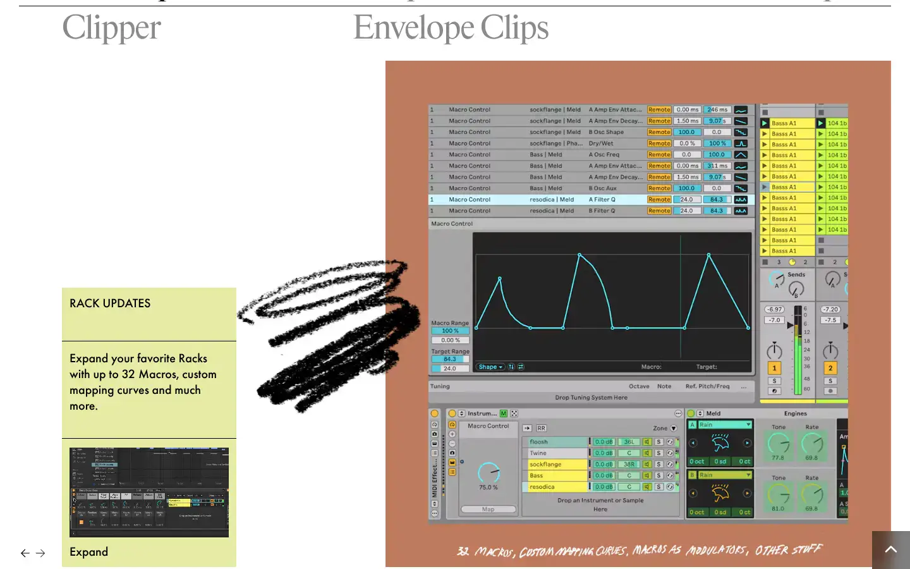
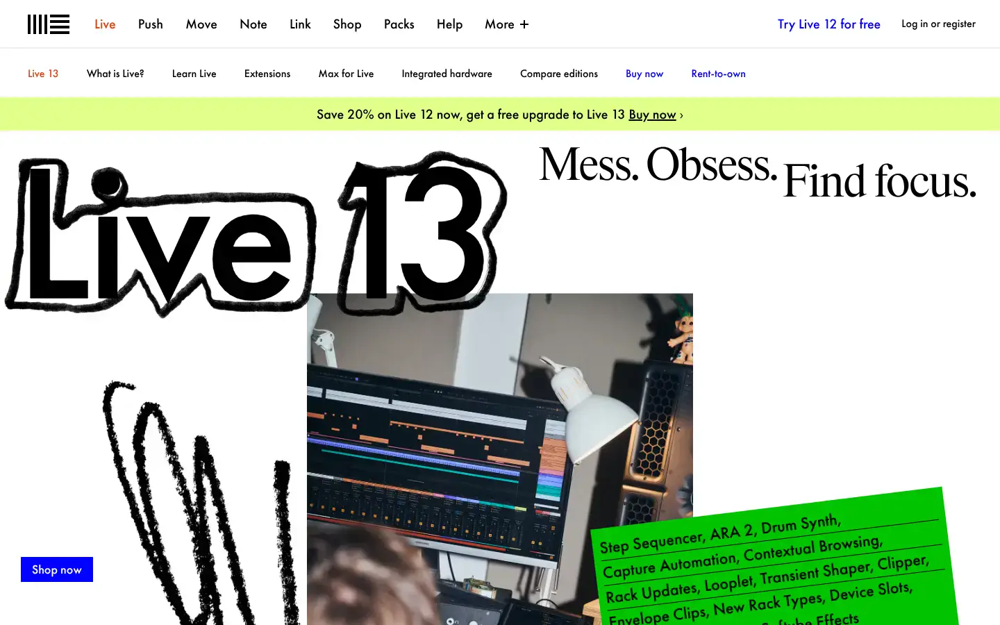

# Ableton Live

Group: **Pro software with dense, clear controls** · Tags: `pro` `music` `flat` `dense`
Source: https://www.ableton.com/en/live/ (the maker's official product page; images are the maker's, kept here for study only)

**Why it is here:** Flat, functional music software: clarity over decoration

- **What makes it work:** Live: flat, functional, zero decoration; devices sit side by side in a strip, each with a small display.
- **Controls:** Small flat knobs and buttons.
- **Displays:** Small device displays (envelopes, filters).
- **Colour:** Light or dark themes, muted colours.
- **Lesson for RUIN-1:** Flat and plain is fine if every device has the same grammar.

