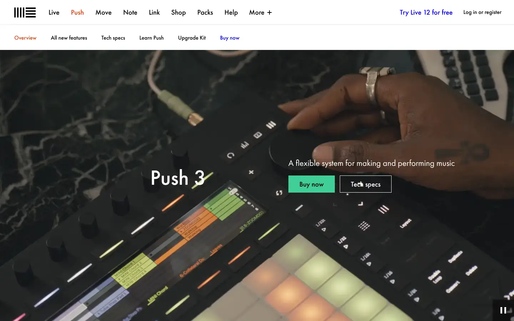
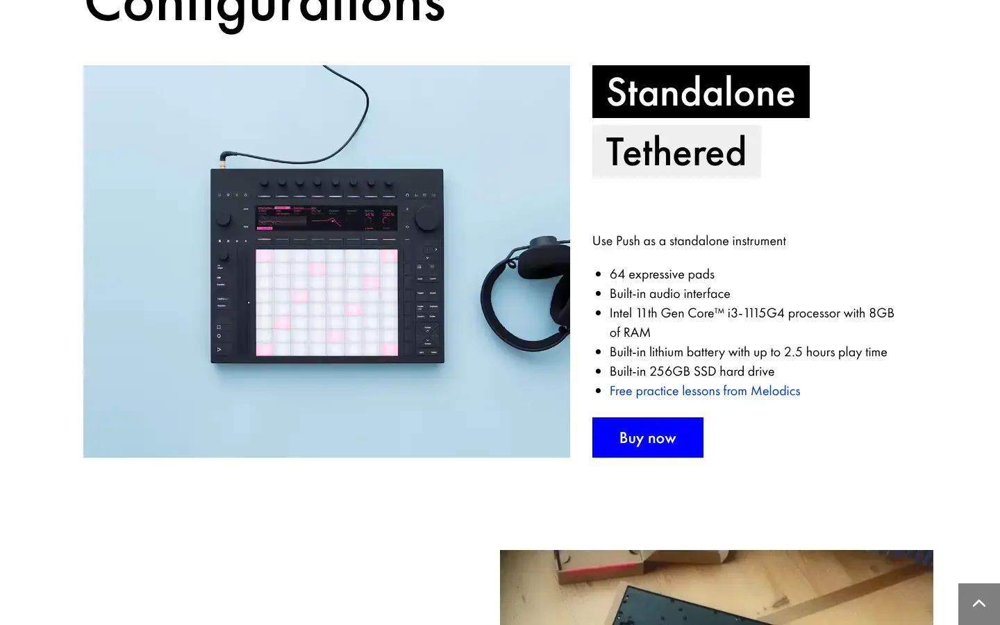

# Ableton Push 3

Group: **Hardware that feels expensive** · Tags: `hardware` `displays` `lighting`
Source: https://www.ableton.com/en/push/ (the maker's official product page; images are the maker's, kept here for study only)

**Why it is here:** Lit pads and a display bar: hardware glow as UI

- **What makes it work:** Push 3: a black surface with a glowing RGB pad grid and a display bar above the encoders.
- **Controls:** Encoders in a row under a display strip; lit pads.
- **Displays:** A long thin display above the encoder row.
- **Colour:** Black with coloured pad light.
- **Lesson for RUIN-1:** A display strip directly above a row of encoders: one screen, one row of controls, direct mapping.

