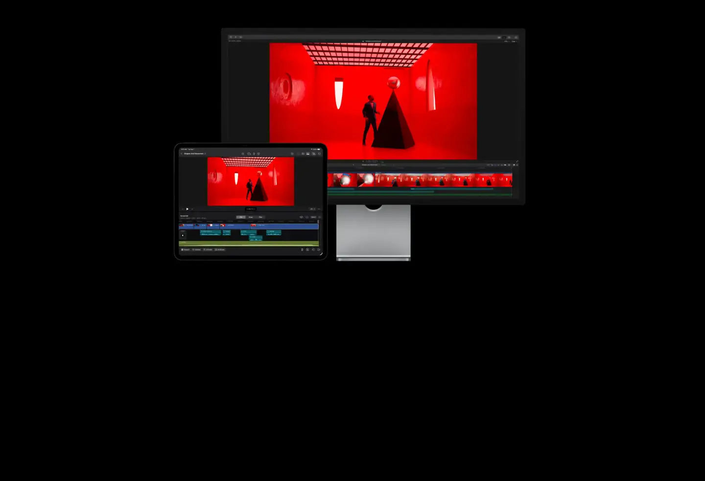
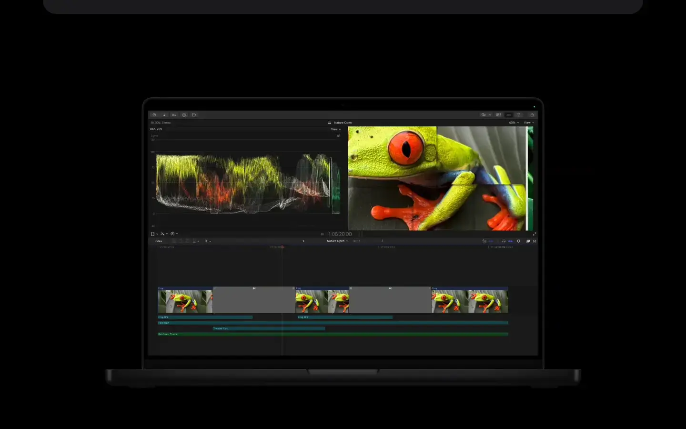

# Apple Final Cut Pro

Group: **The Siren family** · Tags: `siren` `software` `dark` `dense`
Source: https://www.apple.com/final-cut-pro/ (the maker's official product page; images are the maker's, kept here for study only)

**Why it is here:** A dark, dense pro app that still feels calm: panels, inspector, colour wheels

- **What makes it work:** Final Cut Pro: a dark editor with a large viewer, a timeline, and a colour-wheels inspector.
- **Controls:** Colour wheels and slim sliders in an inspector column.
- **Displays:** The viewer dominates; scopes are small and precise.
- **Colour:** Near-black chrome; colour comes from the footage.
- **Lesson for RUIN-1:** Give the main display the most room, controls in a narrow, quiet inspector.

