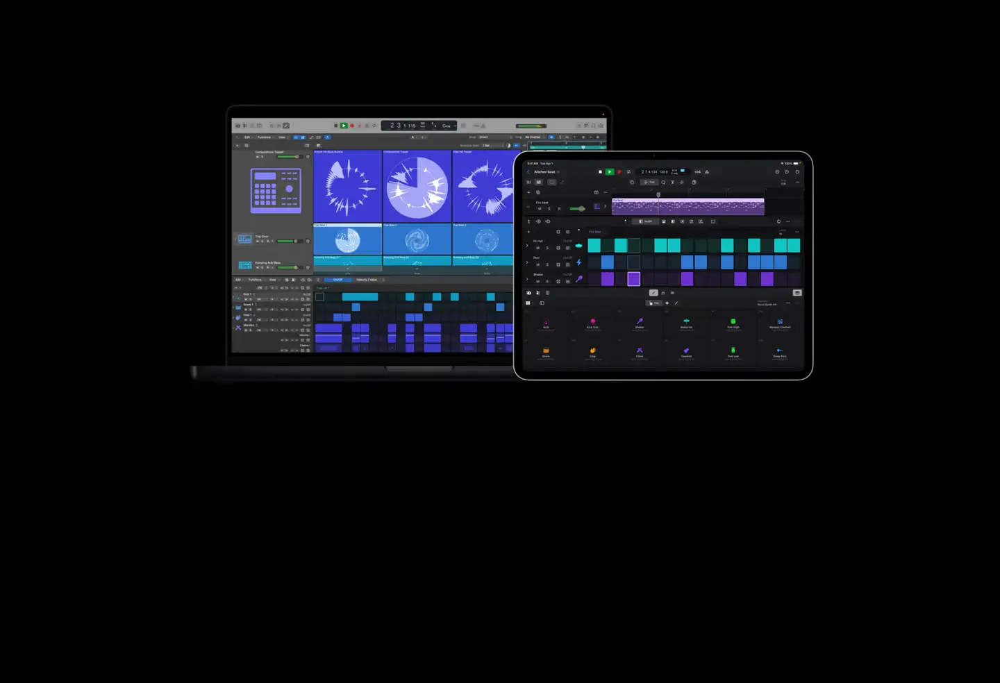
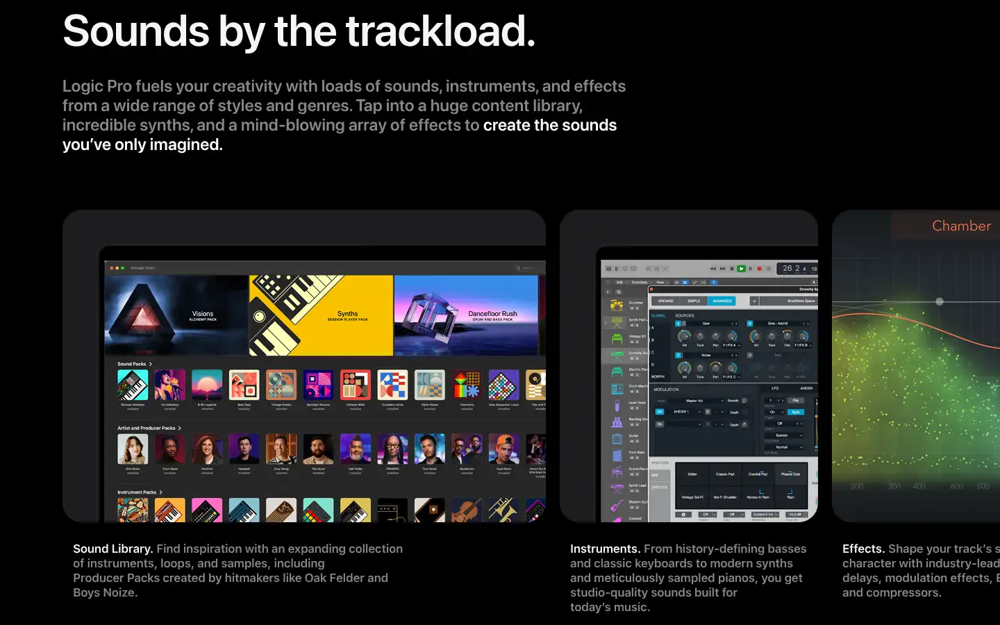
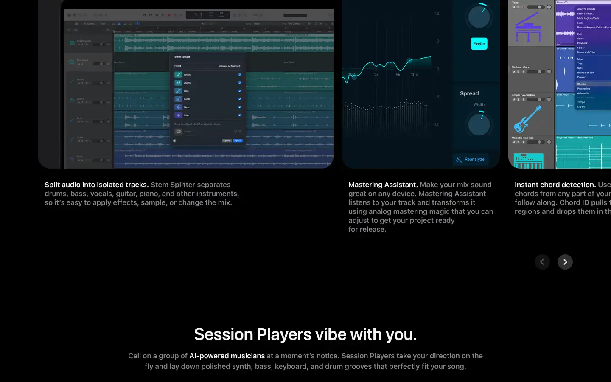
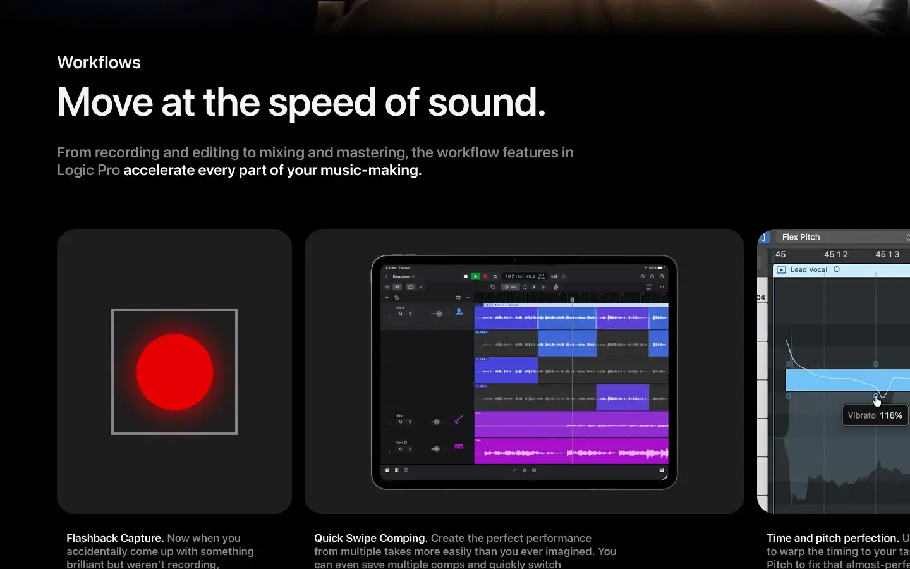

# Apple Logic Pro

Group: **The Siren family** · Tags: `siren` `music` `software` `synth` `dense`
Source: https://www.apple.com/logic-pro/ (the maker's official product page; images are the maker's, kept here for study only)

**Why it is here:** Apple's pro music app: plugin UIs (Alchemy, Sample Alchemy, ChromaGlow), dark mode, precision

- **What makes it work:** Logic Pro on Mac and iPad: dark grey panels, coloured regions and instrument faces (Alchemy, Sample Alchemy, ChromaGlow) inside one consistent shell.
- **Controls:** Round knobs with value arcs; flat sliders; plug-ins framed by a calm dark shell.
- **Displays:** Big waveform and spectrum displays that light up in one colour per area.
- **Colour:** Dark grey with blues and purples; colour only on content.
- **Lesson for RUIN-1:** A neutral, dark shell lets each module's colourful display carry the colour.

