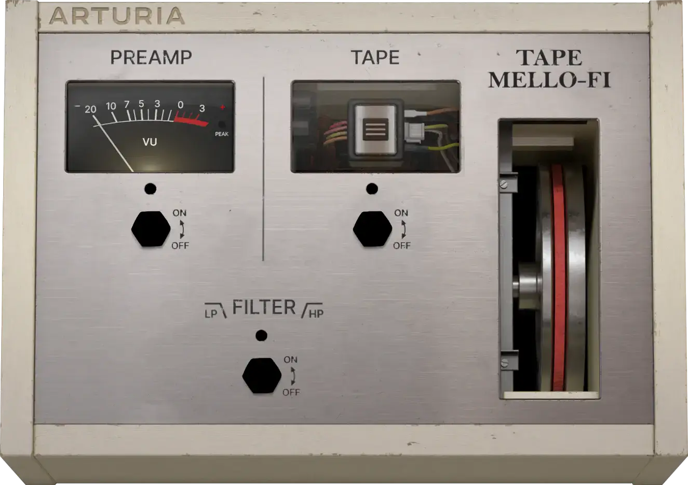
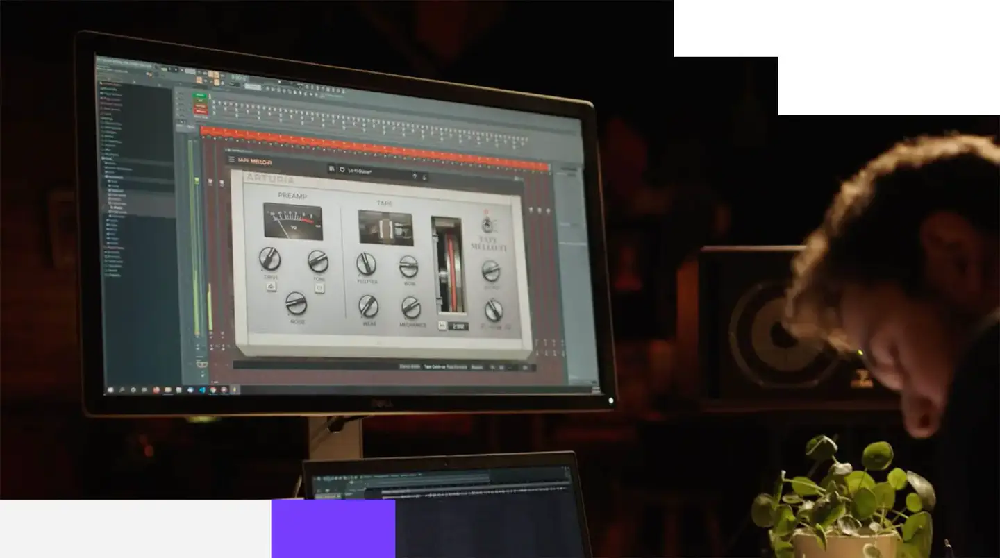

# Arturia Tape MELLO-FI

Group: **Dark, cinematic, LORN-fit** · Tags: `lorn` `plugin` `worn` `tape` `skeuo`
Source: https://www.arturia.com/products/software-effects/tape-mello-fi/overview (the maker's official product page; images are the maker's, kept here for study only)

**Why it is here:** Tape wear and degradation made visible and physical

- **What makes it work:** Tape MELLO-FI: a silver hardware box with a VU meter, a tape window and chunky knobs.
- **Controls:** Big black knobs with hex grips, a vertical slider.
- **Displays:** A VU meter and a tape reel window.
- **Colour:** Silver-grey metal, black.
- **Lesson for RUIN-1:** Show the tape: a window onto the reel tells you what the effect does without words.

