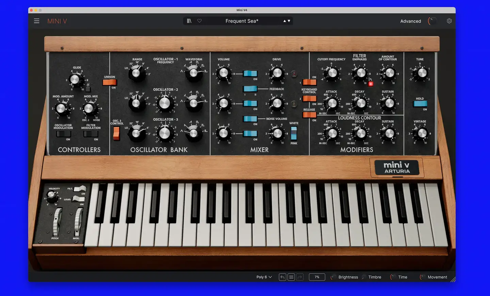
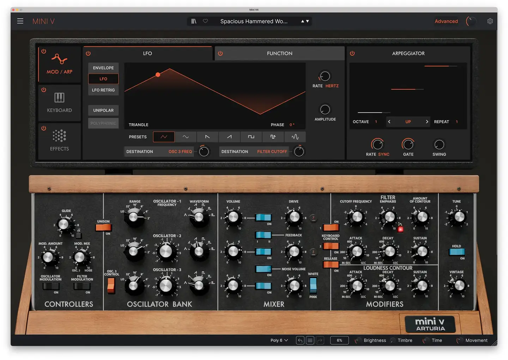
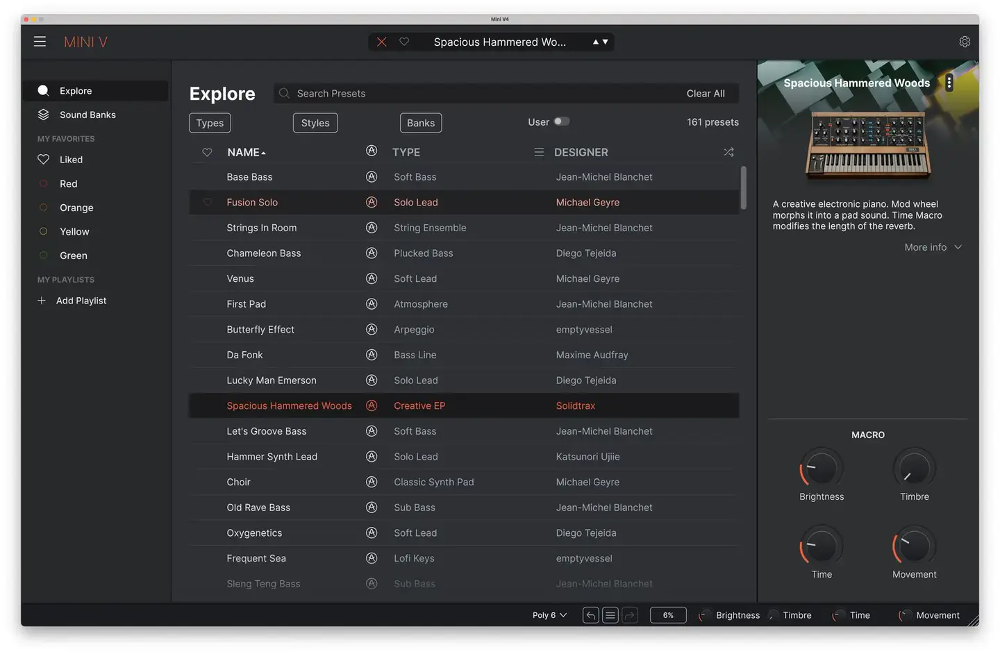

# Arturia Mini V

Group: **Synths and plugins** · Tags: `synth` `skeuo` `materials`
Source: https://www.arturia.com/products/software-instruments/mini-v/overview (the maker's official product page; images are the maker's, kept here for study only)

**Why it is here:** A Minimoog recreation: wood, metal and real knobs on screen

- **What makes it work:** Mini V: a photoreal Minimoog (wood, black panel, blue switches) with an advanced modern panel that slides out above.
- **Controls:** Photoreal black knobs with skirts, coloured rocker switches.
- **Displays:** The advanced panel adds modern displays (envelopes, curves) above the hardware face.
- **Colour:** Black panel, wood, blue and orange switches, red/orange displays.
- **Lesson for RUIN-1:** Hardware look for the main face, modern displays on top: a direct model for skeuo plus displays.

