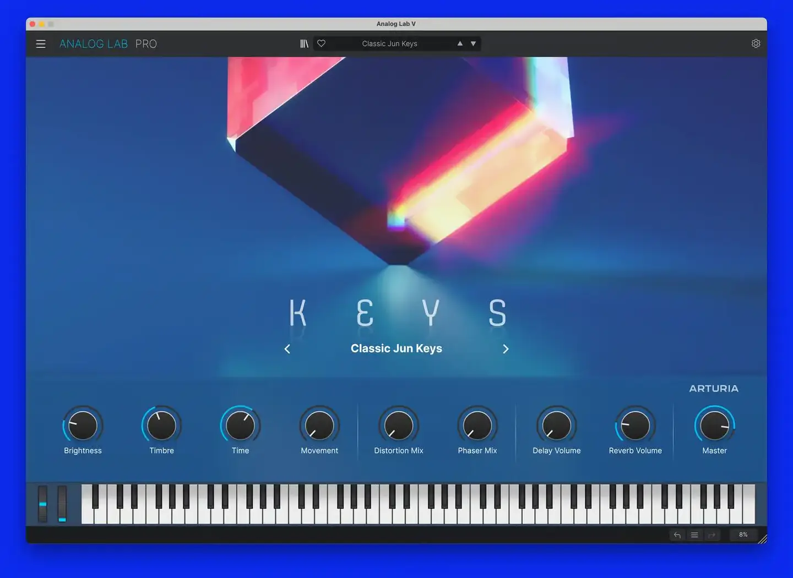
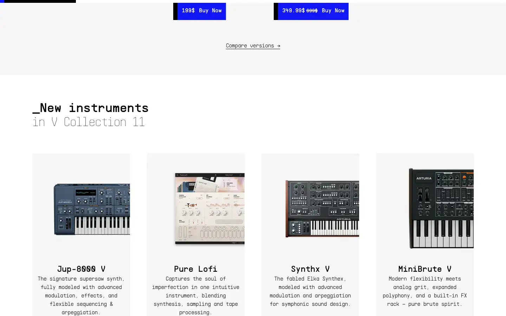

# Arturia V Collection

Group: **Synths and plugins** · Tags: `synth` `skeuo` `materials`
Source: https://www.arturia.com/products/software-instruments/v-collection/overview (the maker's official product page; images are the maker's, kept here for study only)

**Why it is here:** Faithful vintage hardware recreations with a clean modern toolbar

- **What makes it work:** V Collection: faithful vintage recreations plus a modern toolbar and preset browser around them.
- **Controls:** Photoreal knobs, keys and switches.
- **Displays:** Mostly none on the instrument faces.
- **Colour:** Each instrument's own colours; the shell is neutral.
- **Lesson for RUIN-1:** A neutral modern shell can frame a very skeuomorphic face without clashing.

