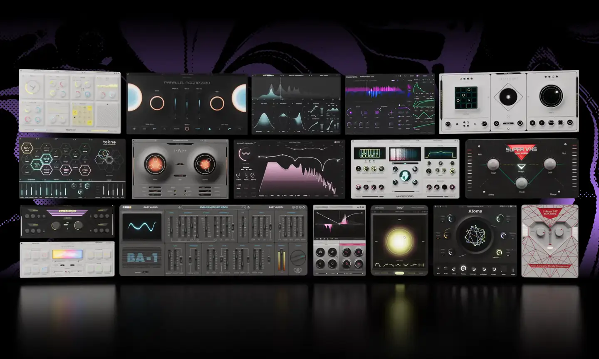
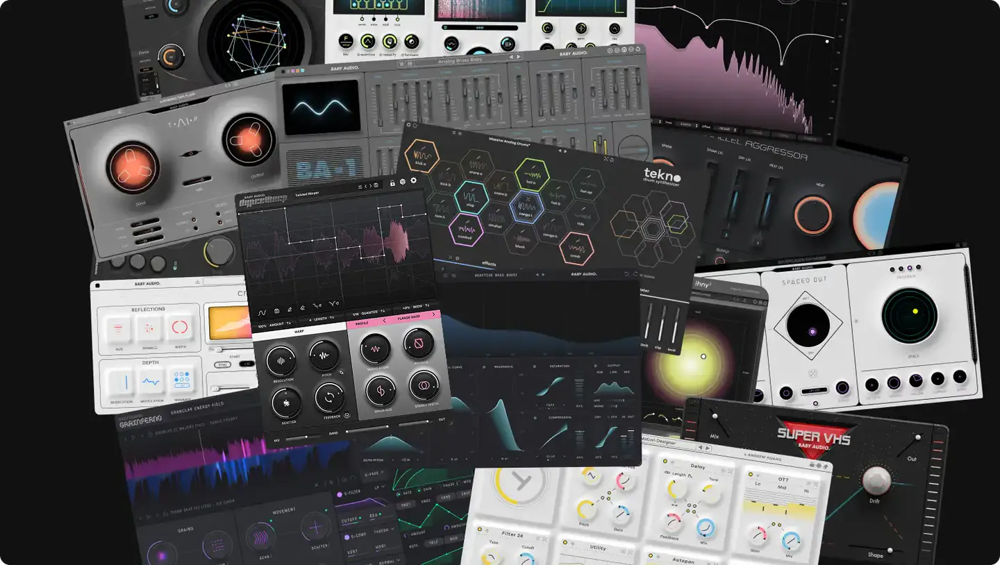

# Baby Audio

Group: **Synths and plugins** · Tags: `plugin` `art-directed`
Source: https://babyaud.io/ (the maker's official product page; images are the maker's, kept here for study only)

**Why it is here:** Modern, playful, art-directed plugin faces

- **What makes it work:** Baby Audio's range: every plug-in art-directed (pastel, chrome, retro hardware), each a strong object.
- **Controls:** Rounded knobs, big buttons, one hero control per plug-in.
- **Displays:** Simple animated displays.
- **Colour:** Each product its own palette.
- **Lesson for RUIN-1:** One hero control and a strong object shape make a plugin memorable; we would keep one palette across pages.

