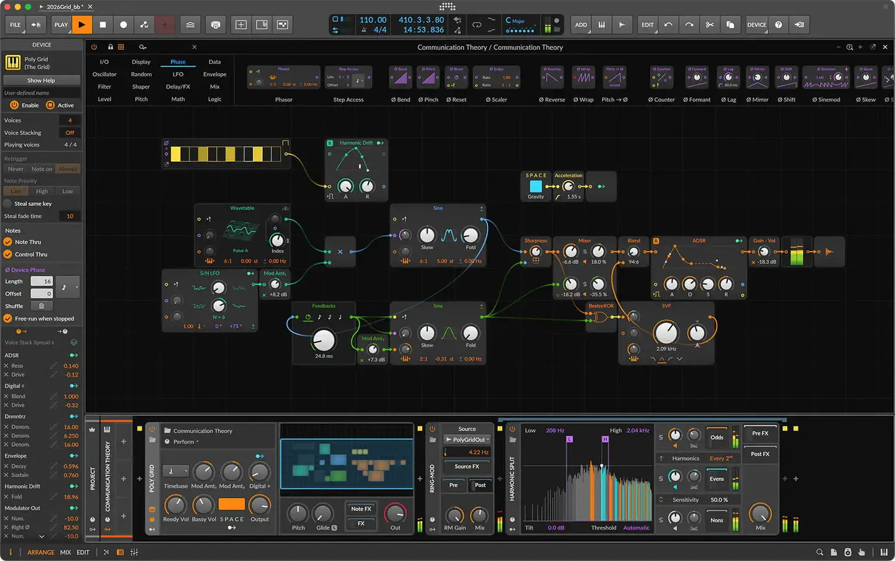
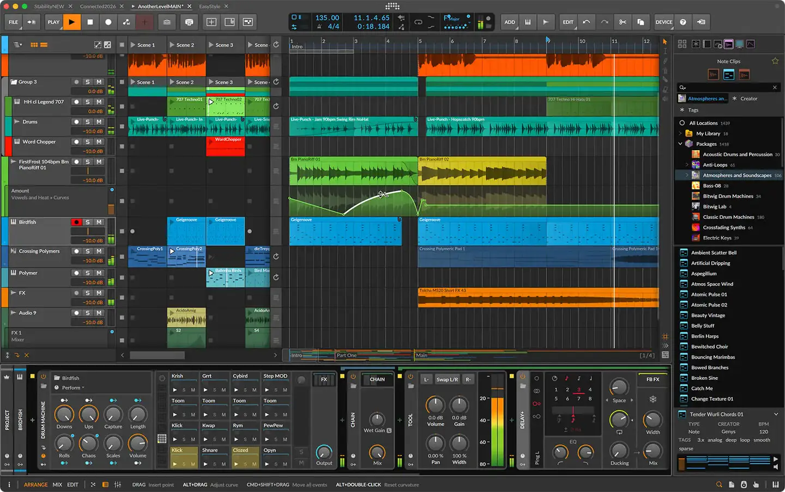

# Bitwig Studio

Group: **Pro software with dense, clear controls** · Tags: `pro` `music` `modulation` `dark`
Source: https://www.bitwig.com/ (the maker's official product page; images are the maker's, kept here for study only)

**Why it is here:** Modern DAW with modulators everywhere; very clear modulation display

- **What makes it work:** Bitwig: a dark DAW with colourful clips, a modular grid and modulators that show their movement on the targets.
- **Controls:** Small knobs with modulation rings.
- **Displays:** Modulator displays, a patchable grid.
- **Colour:** Dark grey with saturated clip colours and orange accent.
- **Lesson for RUIN-1:** Show modulation on the target knob (a moving ring), not only on the source.

