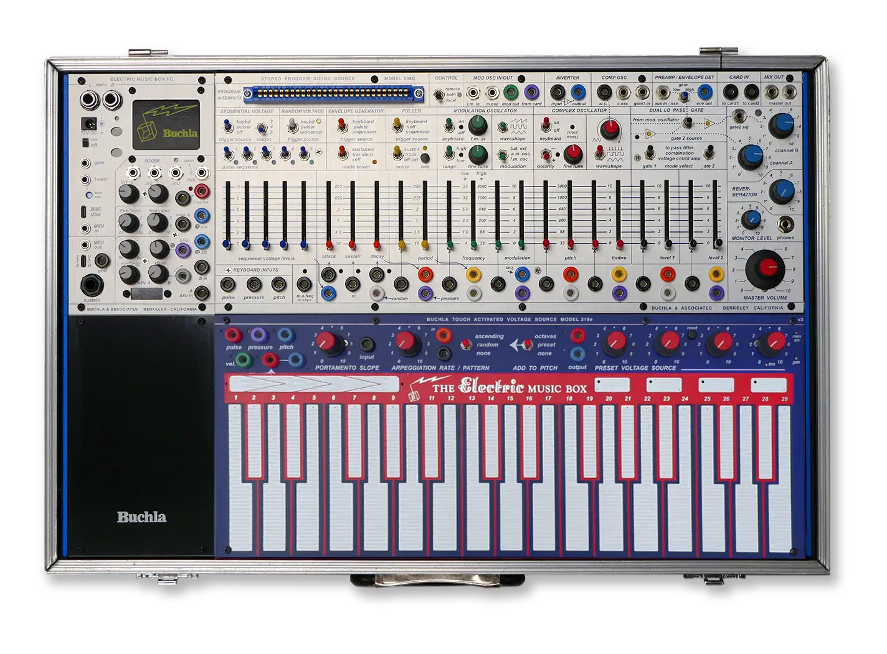
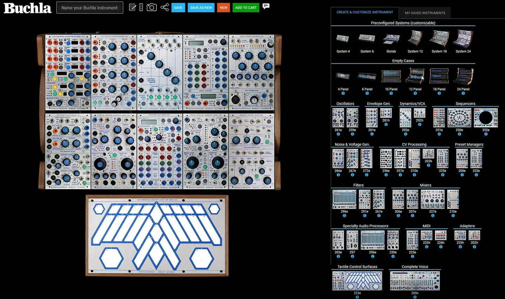
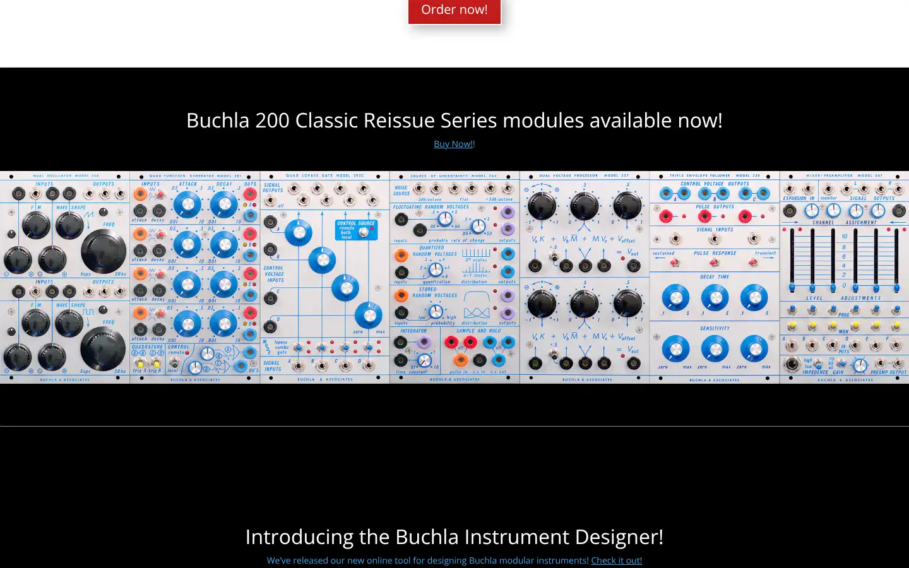

# Buchla

Group: **Hardware that feels expensive** · Tags: `hardware` `synth` `colour-coding` `modules`
Source: https://buchla.com/ (the maker's official product page; images are the maker's, kept here for study only)

**Why it is here:** Colour-coded modular panels: iconic, strange, precise

- **What makes it work:** Buchla Easel and 200 series: white panels with colour-coded jacks, knobs and sliders.
- **Controls:** Coloured knobs and slider caps by function.
- **Displays:** None; the panel is the display.
- **Colour:** White, with red, blue, green, yellow by function.
- **Lesson for RUIN-1:** Colour by function across a whole panel; an iconic, strange-but-precise look.

