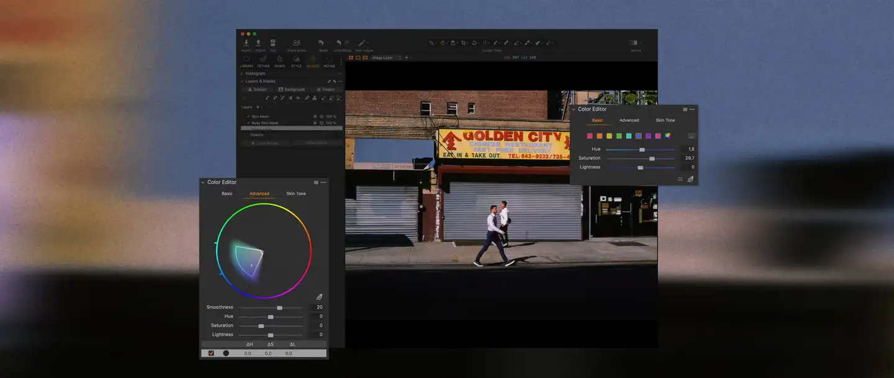

# Capture One

Group: **Pro software with dense, clear controls** · Tags: `pro` `dark` `dense`
Source: https://www.captureone.com/en (the maker's official product page; images are the maker's, kept here for study only)

**Why it is here:** Pro photo editing: dark, dense tool panels and colour tools

- **What makes it work:** Capture One: a dark photo editor with tool panels and a large colour wheel.
- **Controls:** Sliders and wheels in a tool panel.
- **Displays:** The photo, plus small histograms.
- **Colour:** Dark grey, colour in content.
- **Lesson for RUIN-1:** Pro editors put the controls in one column so the display gets the space.

