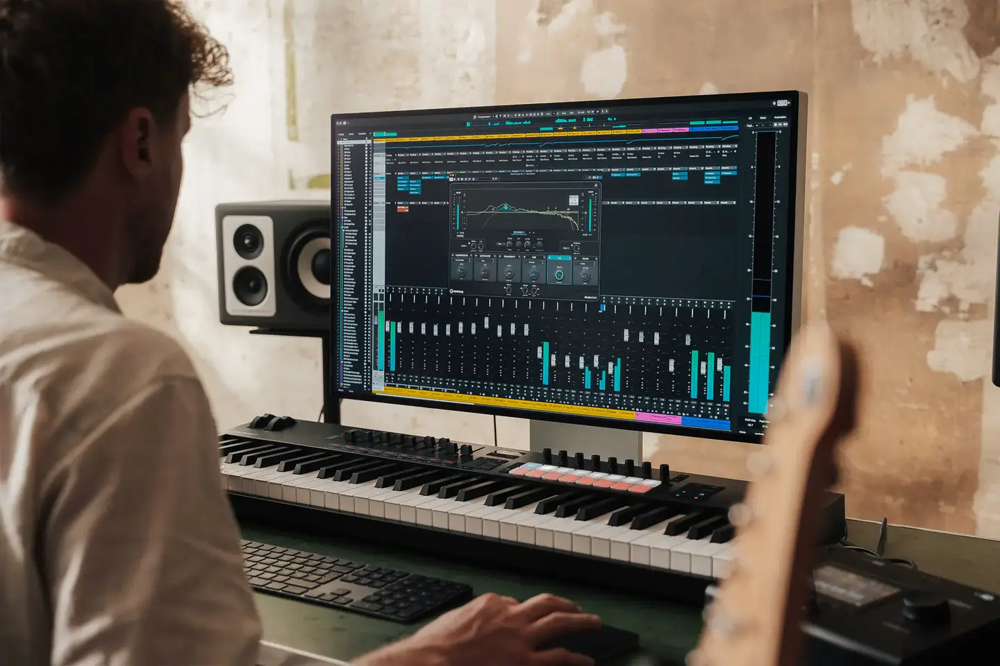

# Steinberg Cubase

Group: **Pro software with dense, clear controls** · Tags: `pro` `music` `dense` `dark`
Source: https://www.steinberg.net/cubase/ (the maker's official product page; images are the maker's, kept here for study only)

**Why it is here:** A big DAW with dense mixers and channel strips

- **What makes it work:** Cubase: a big DAW with mixers, channel strips and editors on a dark grey theme.
- **Controls:** Faders, knobs, channel strips.
- **Displays:** Meters and waveforms.
- **Colour:** Dark grey with blue and colourful tracks.
- **Lesson for RUIN-1:** Channel-strip layouts (one column per source) are a familiar way to show many sources.

