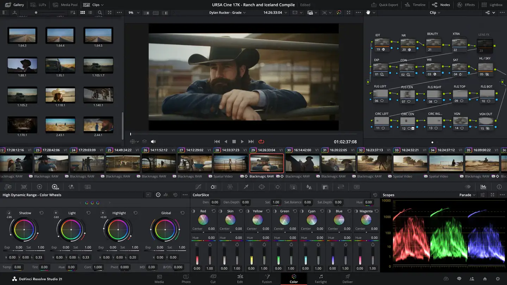
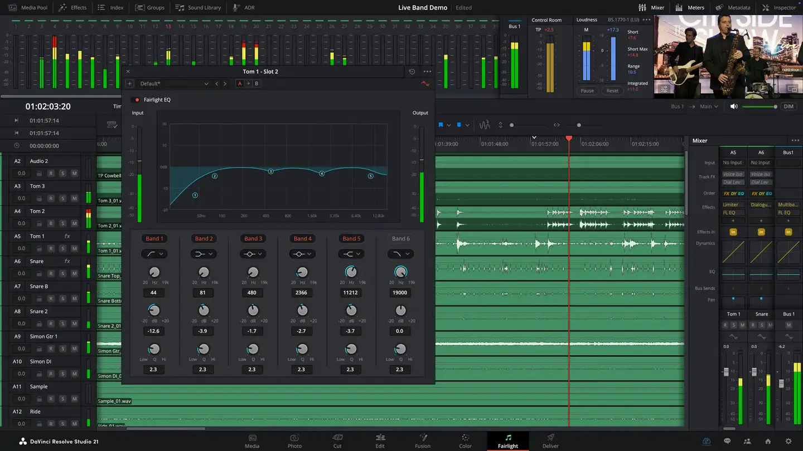
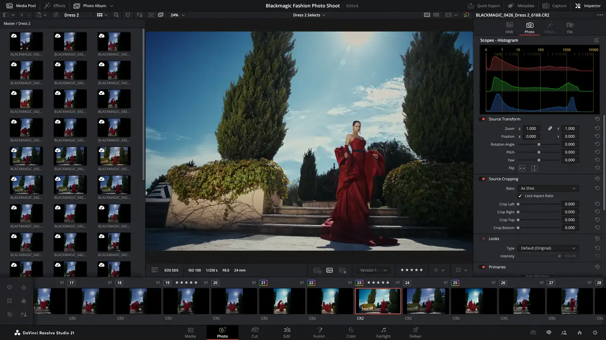
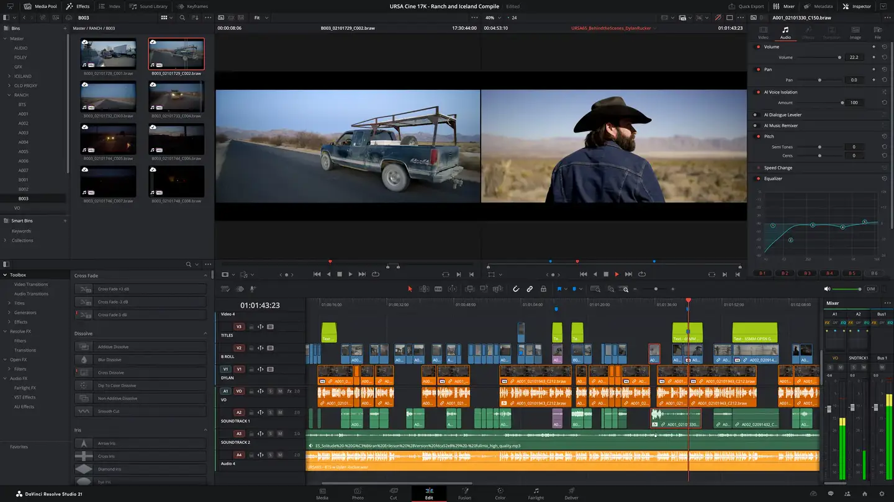

# DaVinci Resolve

Group: **Pro software with dense, clear controls** · Tags: `pro` `dark` `dense` `software`
Source: https://www.blackmagicdesign.com/products/davinciresolve (the maker's official product page; images are the maker's, kept here for study only)

**Why it is here:** Dark, very dense pro UI where hundreds of controls stay calm

- **What makes it work:** Resolve: an extremely dense dark UI (edit, colour, Fairlight audio) that still looks calm: everything aligned, small grey type, colour only in content.
- **Controls:** Colour wheels, slim sliders, knob rows in the mixer.
- **Displays:** Big viewer, precise scopes, waveform lanes.
- **Colour:** Very dark grey, white text, coloured content.
- **Lesson for RUIN-1:** Hundreds of controls stay calm with strict alignment, small muted labels and colour only where content is.

