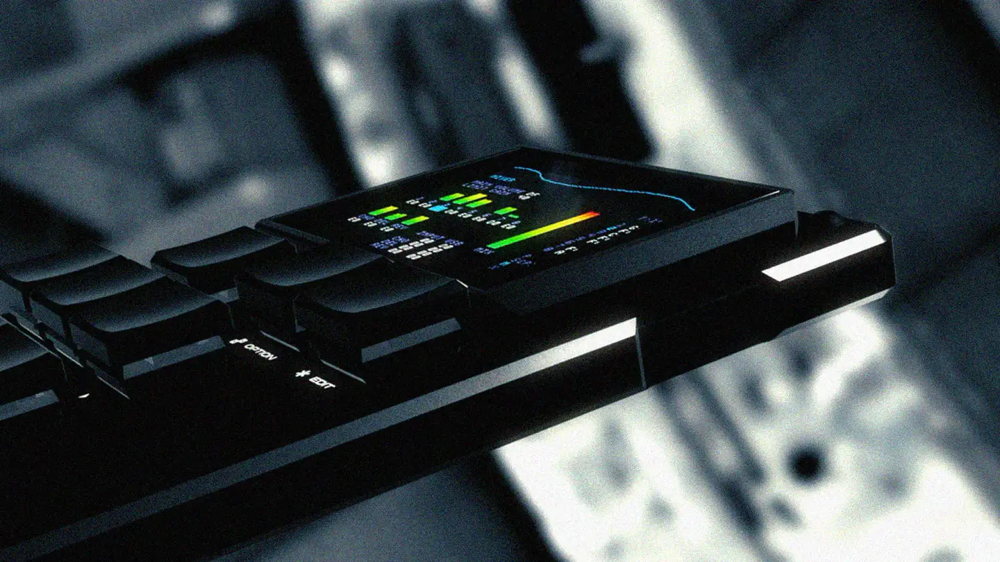
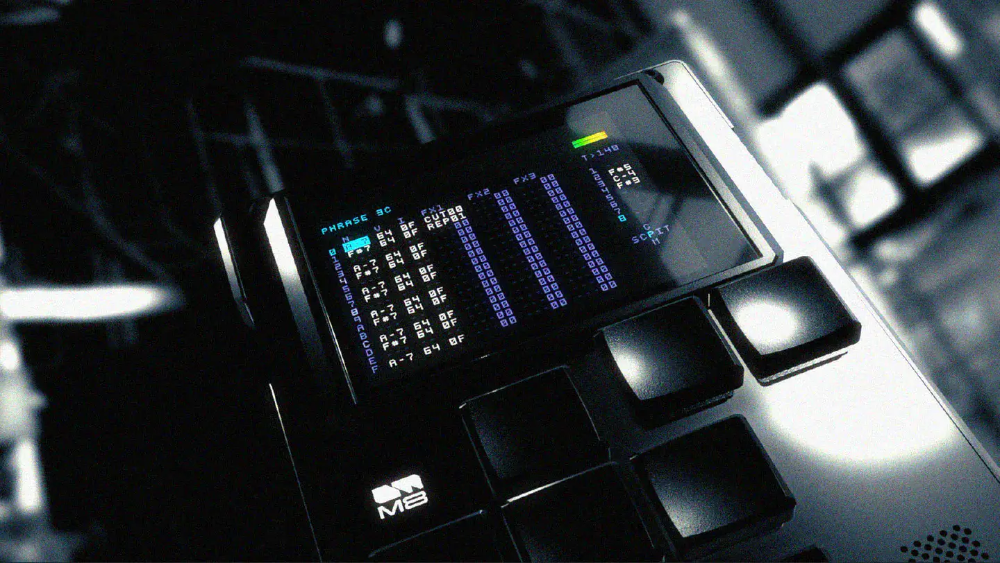
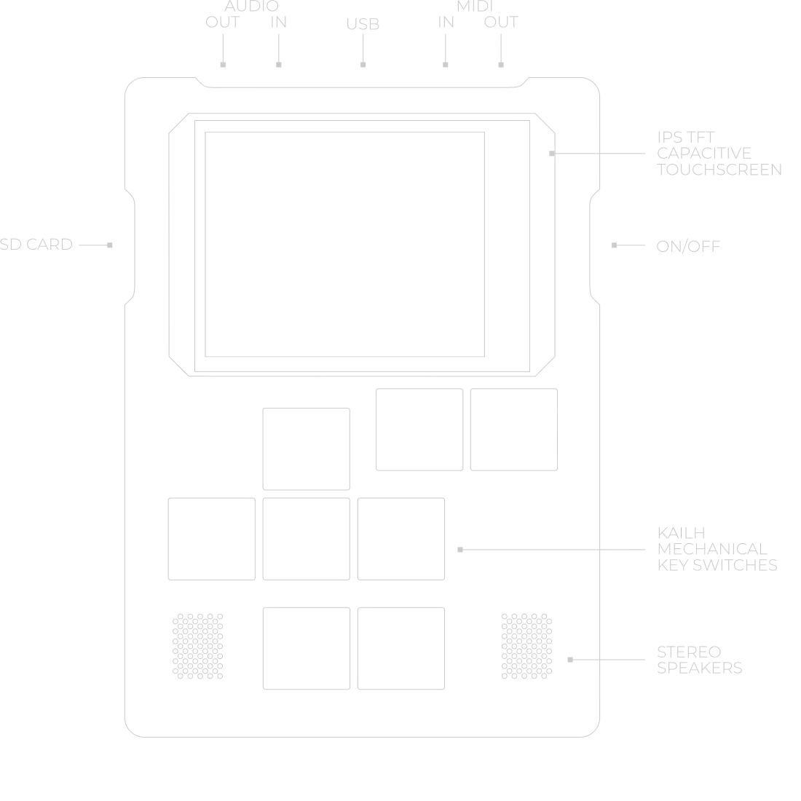

# Dirtywave M8

Group: **Hardware that feels expensive** · Tags: `hardware` `displays` `dense`
Source: https://dirtywave.com/ (the maker's official product page; images are the maker's, kept here for study only)

**Why it is here:** A tiny tracker: dense pixel UI that people love

- **What makes it work:** M8: a tiny black device with a pixel tracker screen, photographed in dark, contrasty light.
- **Controls:** Few chunky keys.
- **Displays:** A tiny colour pixel screen.
- **Colour:** Black with neon screen colours.
- **Lesson for RUIN-1:** A small glowing screen in a dark object, lit hard from one side: a cinematic product mood.

