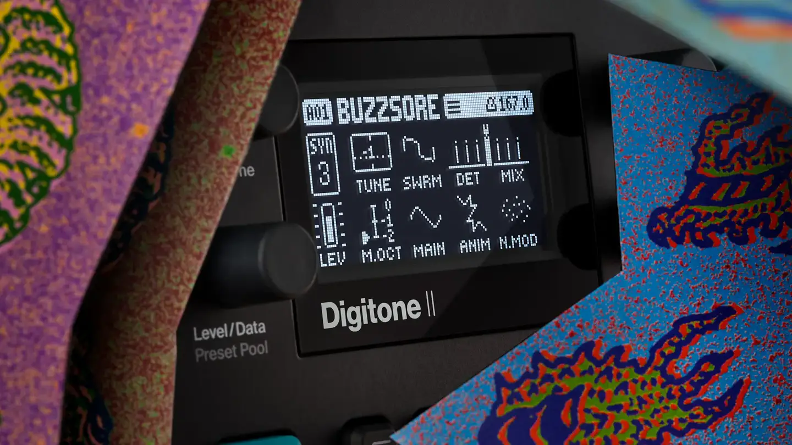
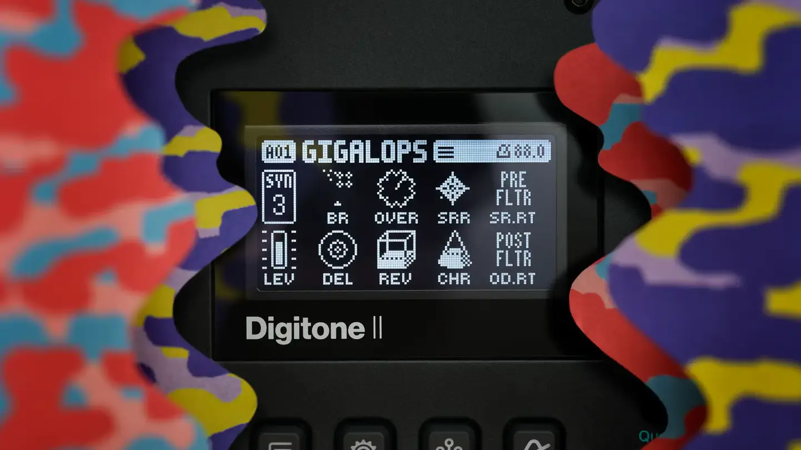
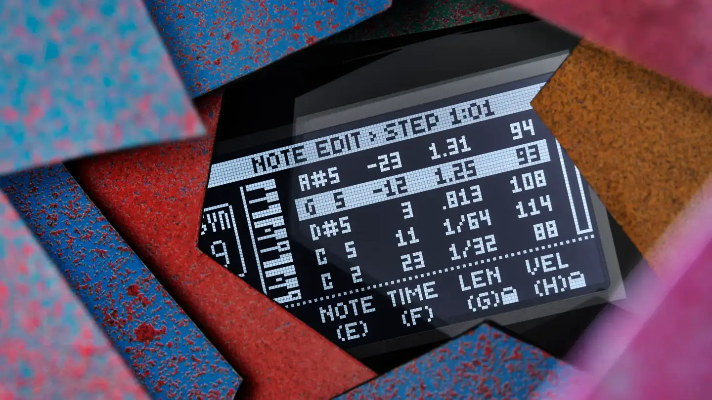
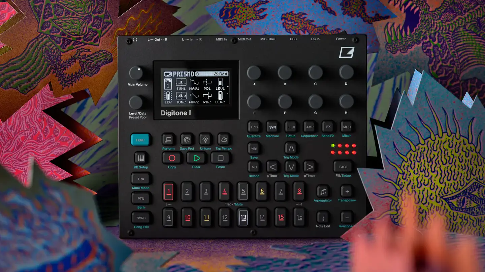

# Elektron Digitone II

Group: **Hardware that feels expensive** · Tags: `hardware` `synth` `dark` `displays`
Source: https://www.elektron.se/explore/digitone-ii (the maker's official product page; images are the maker's, kept here for study only)

**Why it is here:** Dark, industrial, tight grid of encoders around one screen

- **What makes it work:** Digitone II: a dark panel, a small high-contrast OLED with big pixel type and icons, encoders round it.
- **Controls:** Rows of identical encoders, trig keys with coloured LEDs.
- **Displays:** An OLED drawing each parameter page as icons and big numbers.
- **Colour:** Black and grey with teal and red LEDs.
- **Lesson for RUIN-1:** A tiny screen can carry a whole page if type is big and each parameter gets an icon.

