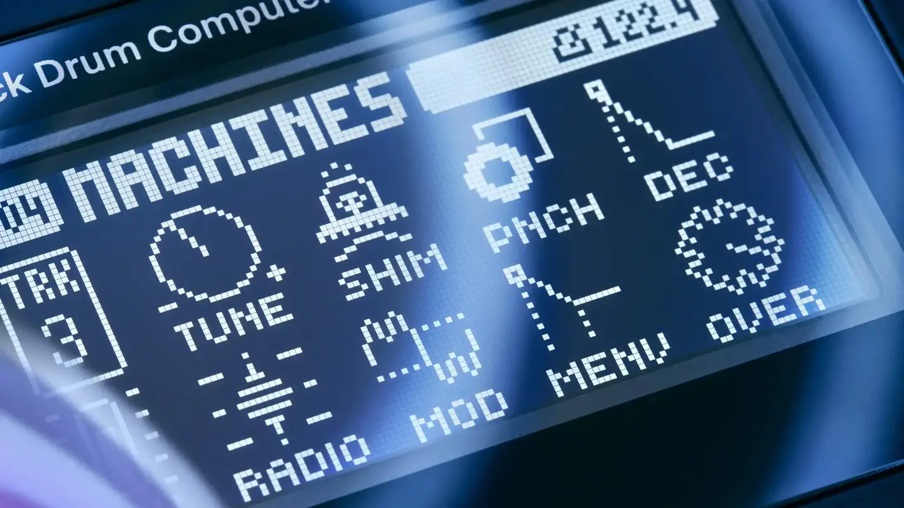
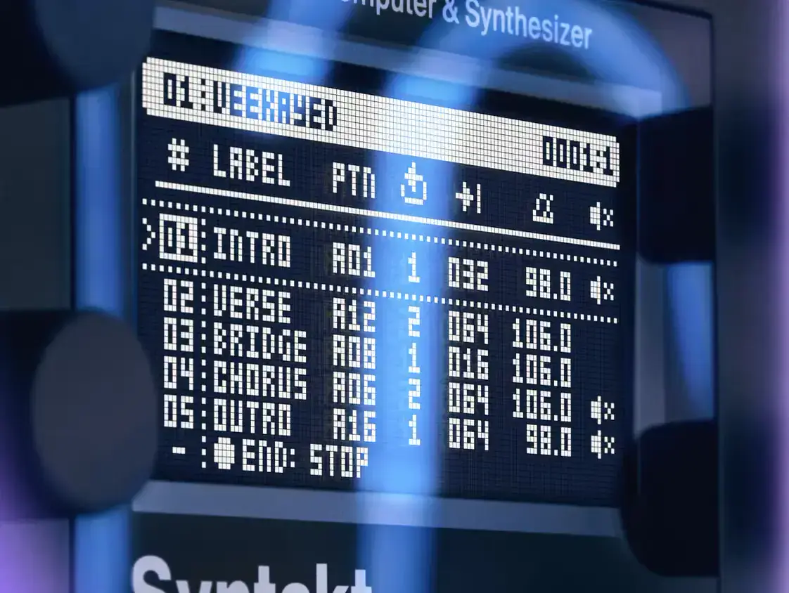
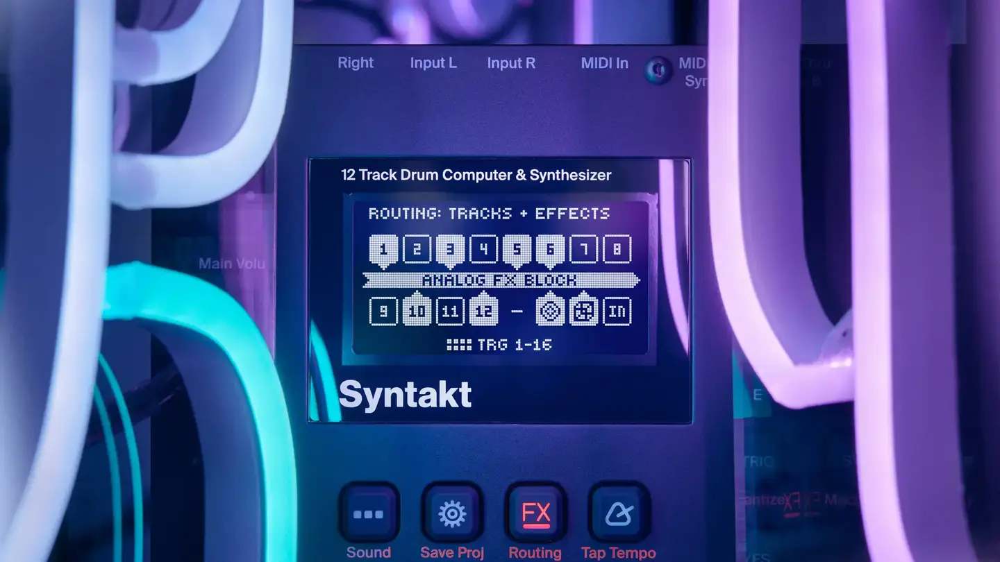
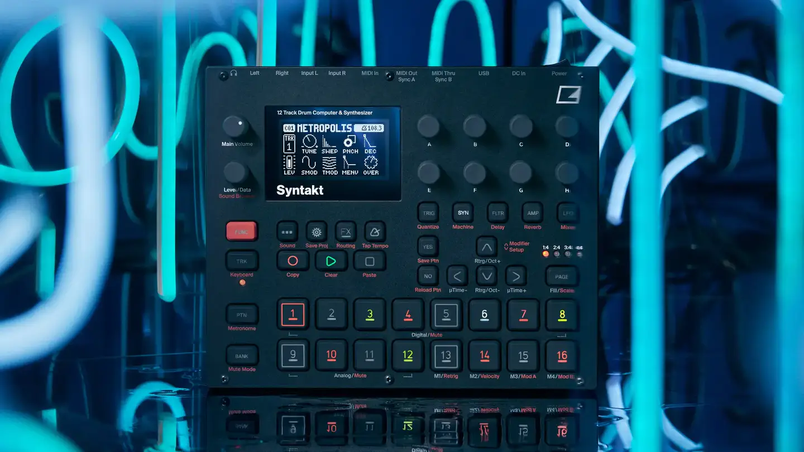

# Elektron Syntakt

Group: **Hardware that feels expensive** · Tags: `hardware` `synth` `dark` `displays`
Source: https://www.elektron.se/explore/syntakt (the maker's official product page; images are the maker's, kept here for study only)

**Why it is here:** Elektron's drum/synth machine: dark panel, coloured trig keys, one small screen

- **What makes it work:** Syntakt: the same Elektron language lit in blue: pixel-type OLED pages, numbered trig keys.
- **Controls:** Encoders, numbered square keys with coloured legends.
- **Displays:** OLED pages of icons (tune, decay, mod) above the encoders they map to.
- **Colour:** Dark panel, blue and red legends.
- **Lesson for RUIN-1:** Map the screen's layout to the knobs under it: the display above each control row.

