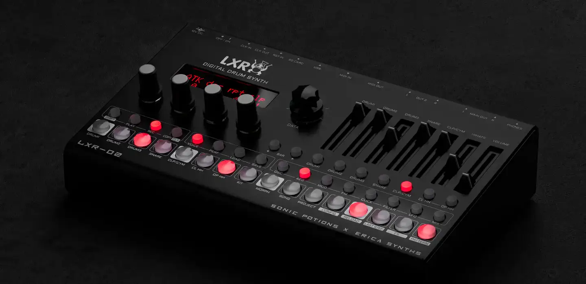
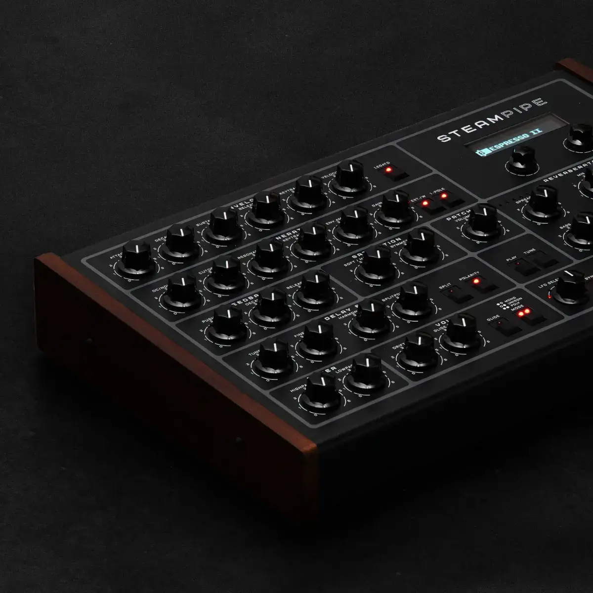
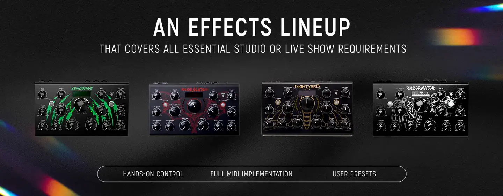

# Erica Synths

Group: **Hardware that feels expensive** · Tags: `hardware` `synth` `dark` `lorn`
Source: https://www.ericasynths.lv/ (the maker's official product page; images are the maker's, kept here for study only)

**Why it is here:** Dark, industrial, Eastern-European hardware: close to LORN's mood

- **What makes it work:** Erica Synths: black industrial hardware with red lit keys, sliders and lots of knobs, shot in the dark.
- **Controls:** Black knobs, sliders, red-lit buttons.
- **Displays:** Small LED displays.
- **Colour:** Black, red, wood on some units.
- **Lesson for RUIN-1:** Black hardware with red light in the dark: almost exactly the siren mood, in a real instrument.

