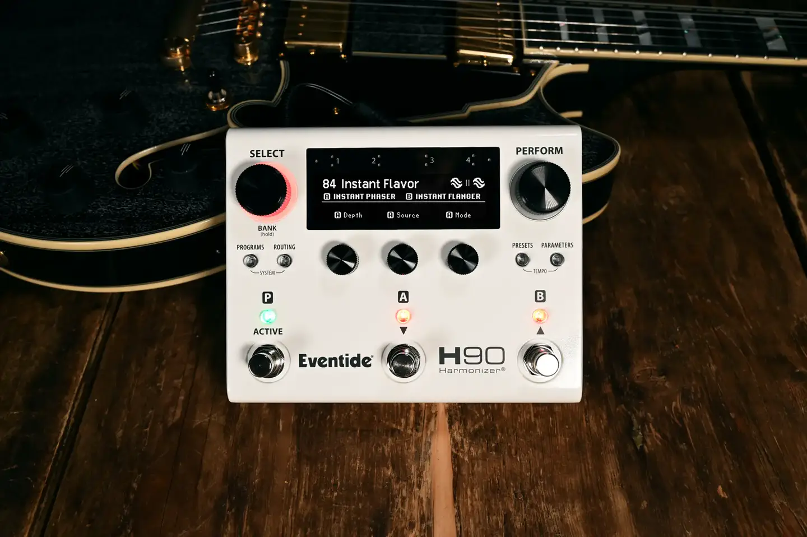
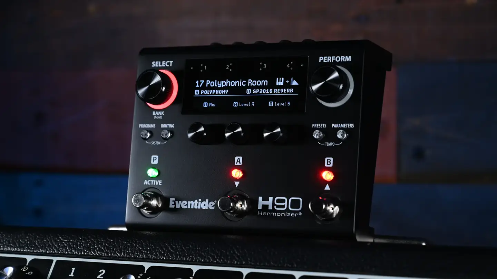
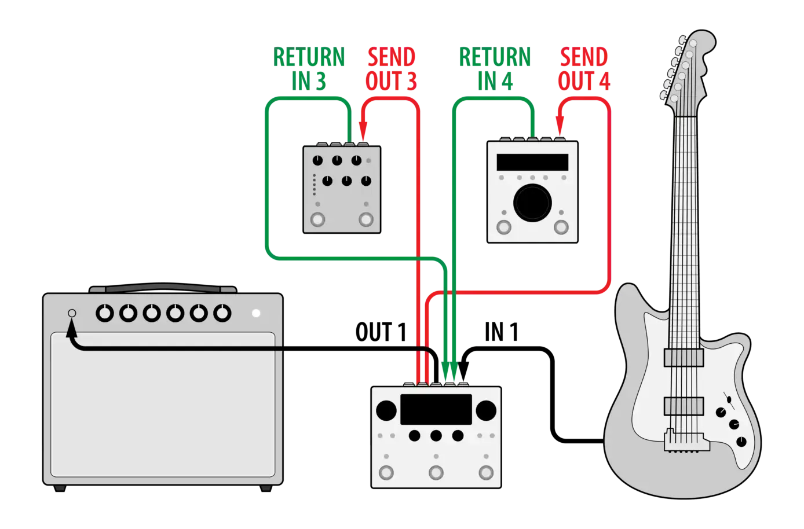

# Eventide H90

Group: **Hardware that feels expensive** · Tags: `hardware` `displays` `dark`
Source: https://www.eventideaudio.com/pedals/h90/ (the maker's official product page; images are the maker's, kept here for study only)

**Why it is here:** A pedal with a dense screen UI that stays readable

- **What makes it work:** H90: a white pedal with a dense OLED, a red knob, lit footswitches.
- **Controls:** Encoders, one red hero knob.
- **Displays:** An OLED with program names and small parameter icons.
- **Colour:** White, black, a single red knob, green/red LEDs.
- **Lesson for RUIN-1:** A single red hero control on a neutral body: our Buy-button rule in hardware.

