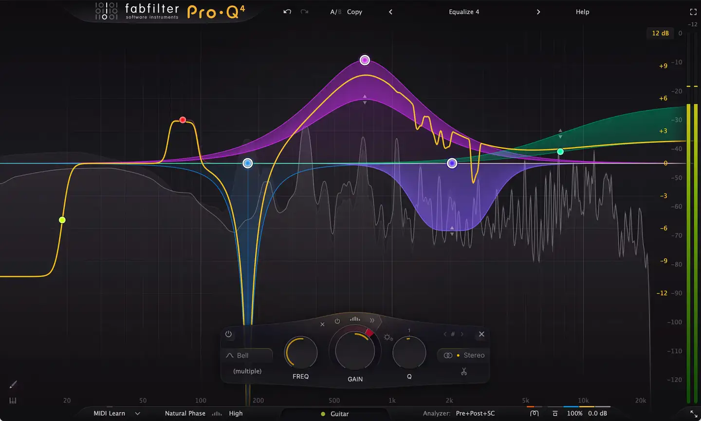
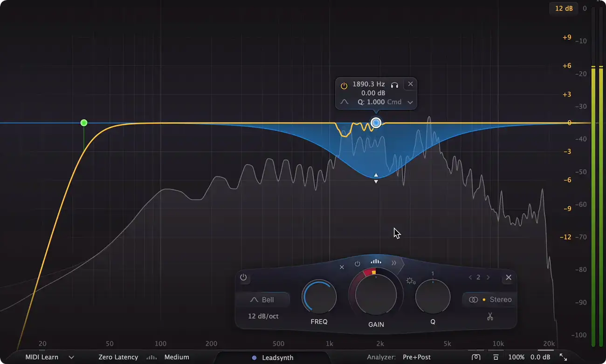
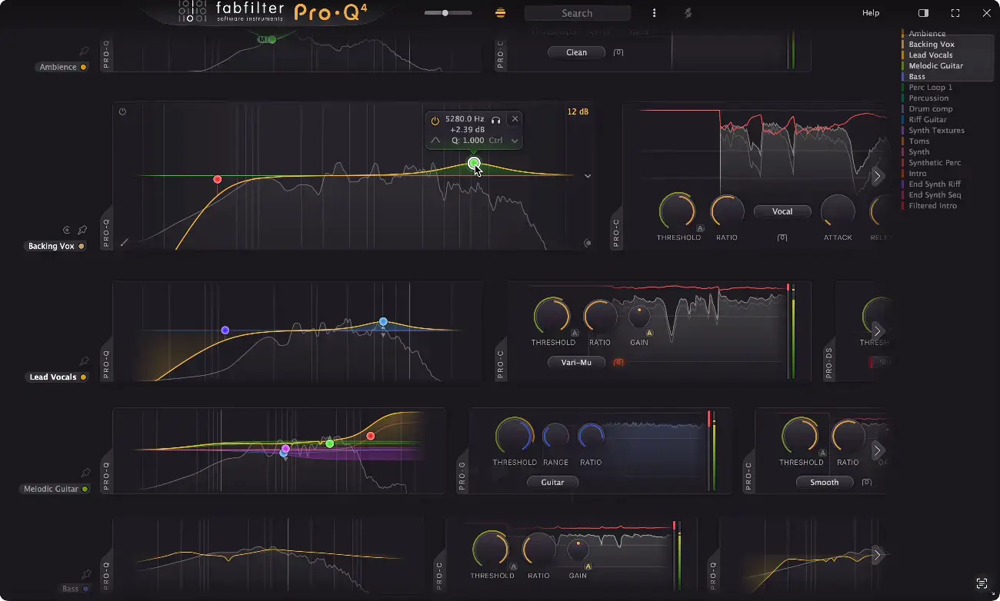
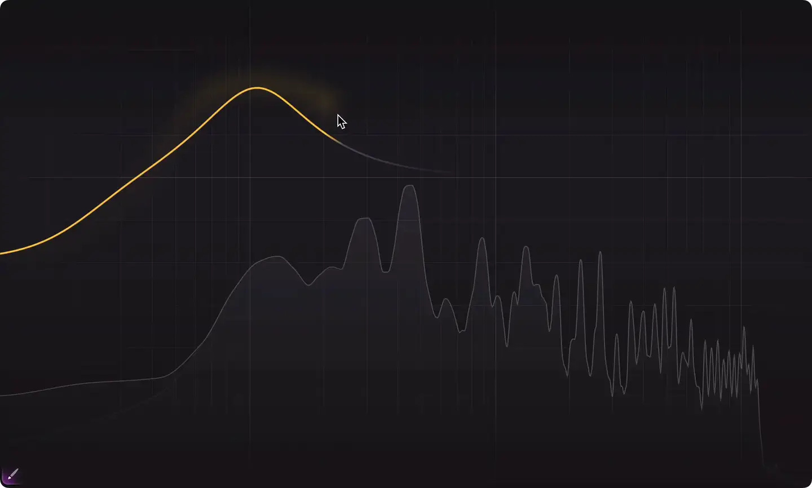

# FabFilter Pro-Q 4

Group: **Synths and plugins** · Tags: `plugin` `displays` `flat` `dark`
Source: https://www.fabfilter.com/products/pro-q-4-equalizer-plug-in (the maker's official product page; images are the maker's, kept here for study only)

**Why it is here:** The gold standard of a big interactive display as the whole interface

- **What makes it work:** Pro-Q 4: one huge interactive display is the interface; controls appear only near the band you touch.
- **Controls:** A floating panel of three knobs under the selected band.
- **Displays:** A full-width spectrum and EQ curve with coloured band fills.
- **Colour:** Dark grey-purple, one colour per band, glowing curves.
- **Lesson for RUIN-1:** Let the display be the control; keep the knob strip small and contextual.

