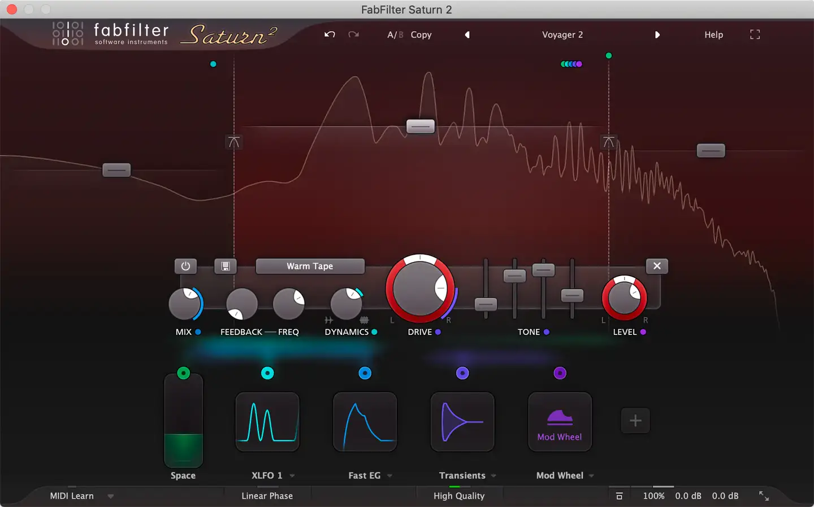
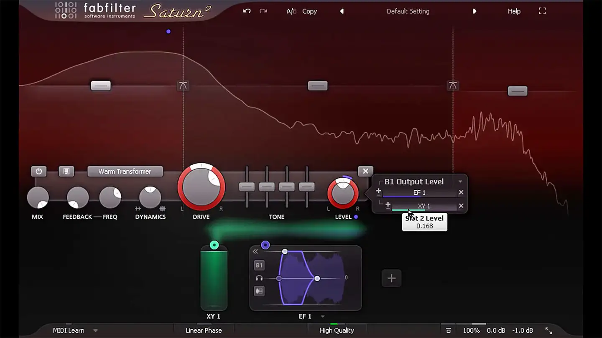
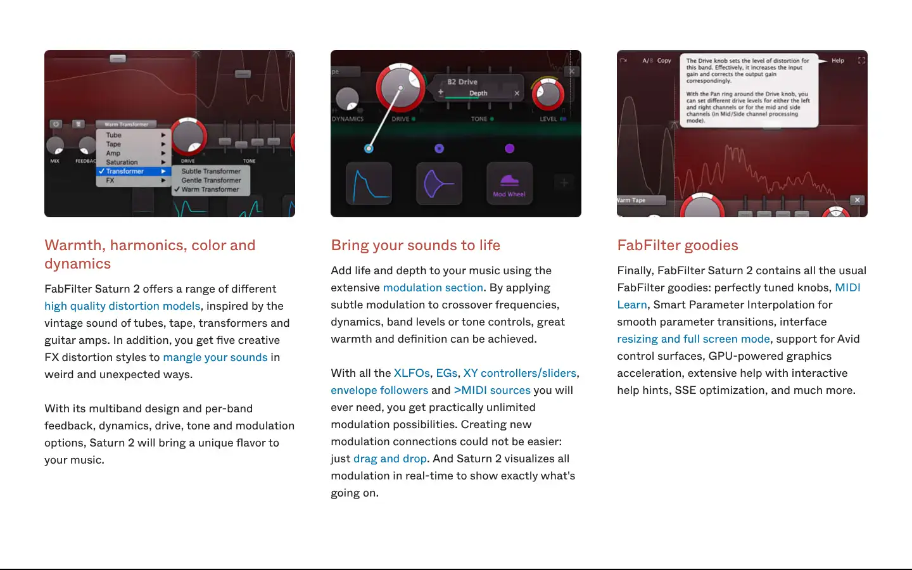

# FabFilter Saturn 2

Group: **Synths and plugins** · Tags: `plugin` `displays` `distortion`
Source: https://www.fabfilter.com/products/saturn-2-multiband-distortion-saturation-plug-in (the maker's official product page; images are the maker's, kept here for study only)

**Why it is here:** Distortion UI: bands, drive and modulation readable in one display

- **What makes it work:** Saturn 2: dark red, a spectrum display with band splits, drive knobs in a strip, modulation sources as small cards.
- **Controls:** Big red drive knob, smaller knobs around it; mod cards below.
- **Displays:** A spectrum display behind the band split.
- **Colour:** Black and deep red, small coloured mod cards.
- **Lesson for RUIN-1:** Proof a distortion UI can live in deep red and black and still be clear: close to our siren palette.

