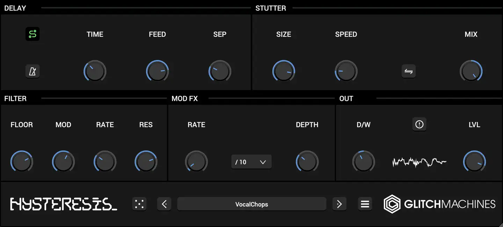
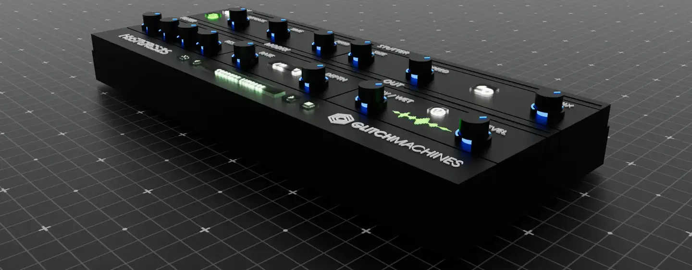

# Glitchmachines Hysteresis

Group: **Dark, cinematic, LORN-fit** · Tags: `lorn` `plugin` `dark`
Source: https://glitchmachines.com/products/hysteresis/ (the maker's official product page; images are the maker's, kept here for study only)

**Why it is here:** Glitchy, dark, sci-fi panels

- **What makes it work:** Hysteresis: a dark panel of blue-ringed knobs grouped in labelled sections, plus a 3D render of it as hardware.
- **Controls:** Uniform knobs with blue rings, section headers.
- **Displays:** Small waveform icon.
- **Colour:** Black, blue rings.
- **Lesson for RUIN-1:** Grouping knobs into named sections on black is the minimum that works.

