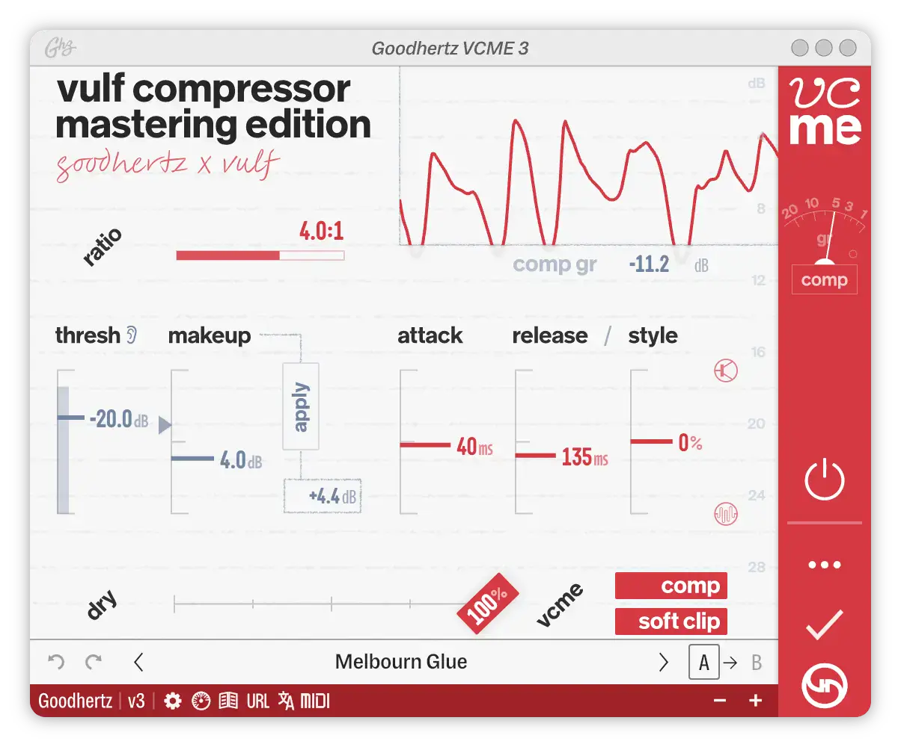
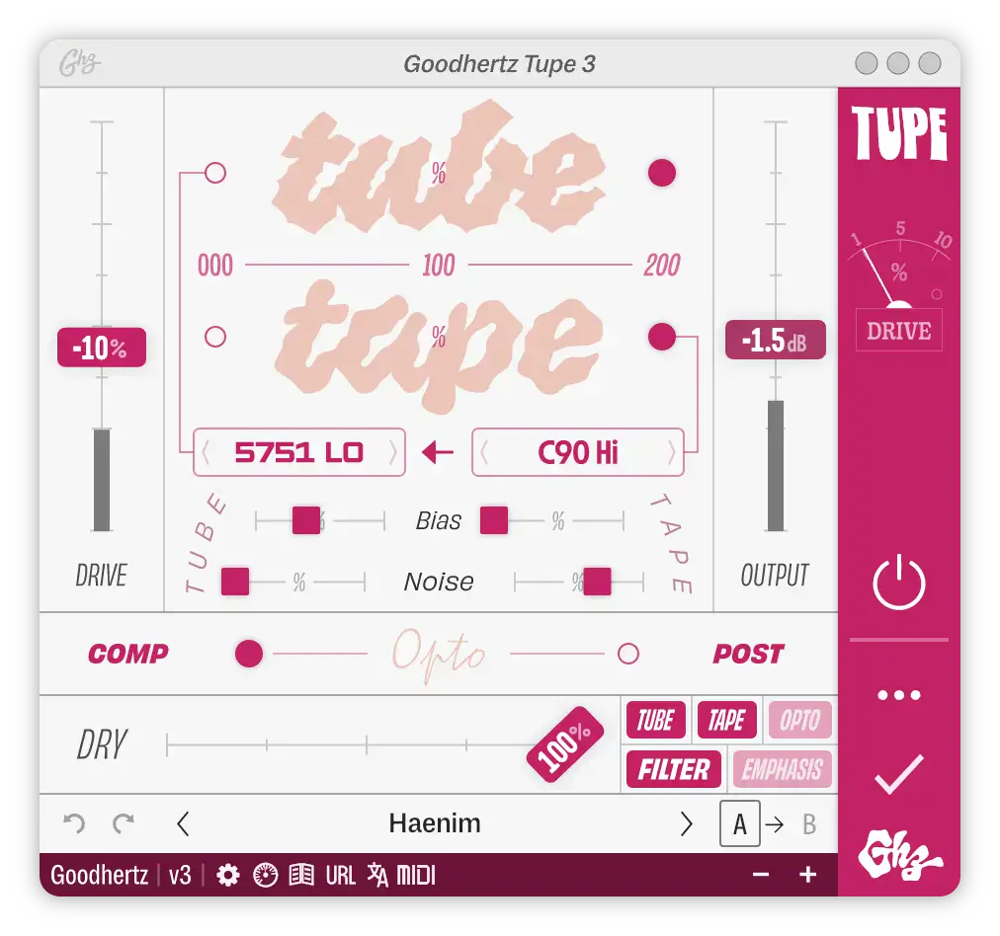
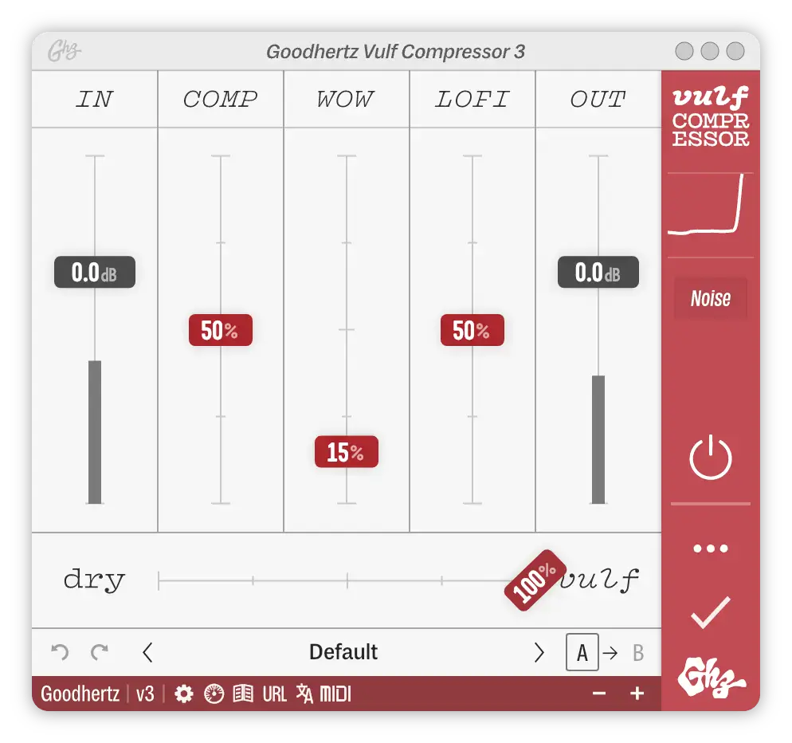
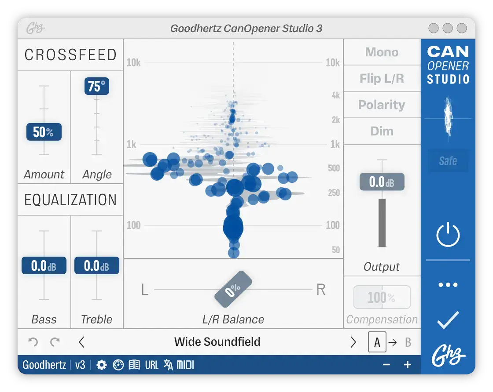

# Goodhertz

Group: **Dark, cinematic, LORN-fit** · Tags: `lorn` `plugin` `worn` `tape`
Source: https://goodhertz.com/ (the maker's official product page; images are the maker's, kept here for study only)

**Why it is here:** Tape wear, wobble and lo-fi plugins: worn, warm, typographic

- **What makes it work:** Goodhertz: playful pastel plugins with big type, thin lines, a coloured side bar and a clear signal flow.
- **Controls:** Slim faders, small chips for values.
- **Displays:** Simple, flat curves.
- **Colour:** Pastels with one strong colour each.
- **Lesson for RUIN-1:** Typographic UI: big labels and clear sections can replace boxes and bevels.

