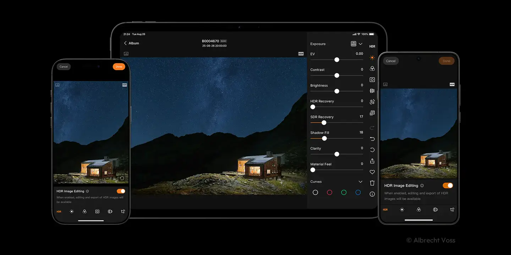
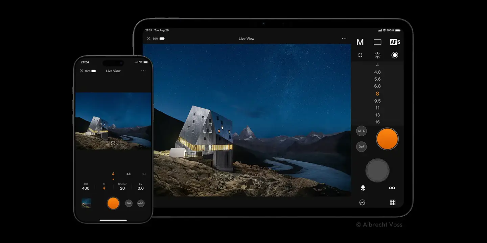
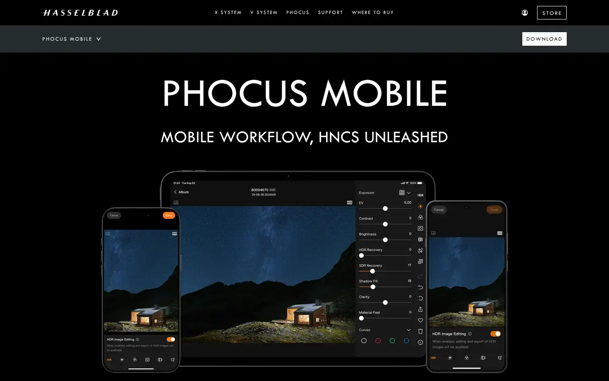

# Hasselblad Phocus

Group: **The Siren family** · Tags: `siren` `dark` `software` `dense`
Source: https://www.hasselblad.com/phocus/ (the maker's official product page; images are the maker's, kept here for study only)

**Why it is here:** Hasselblad's own pro software: the brand behind our site's calm, expensive restraint, applied to a dense pro tool

- **What makes it work:** Phocus Mobile on phone and tablet: the photo fills the screen, and the tools are a thin column of tiny white labels and sliders at the edge, with one orange accent.
- **Controls:** Thin horizontal sliders with a small value at the end; icon buttons in a narrow rail.
- **Displays:** The image is the display; histograms are small and quiet.
- **Colour:** Black chrome, white text, one orange accent dot for the active state.
- **Lesson for RUIN-1:** Let the displays be the content and push controls to a quiet rail; one warm accent marks what is active.

