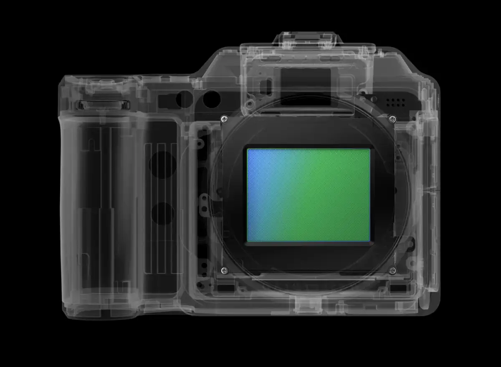
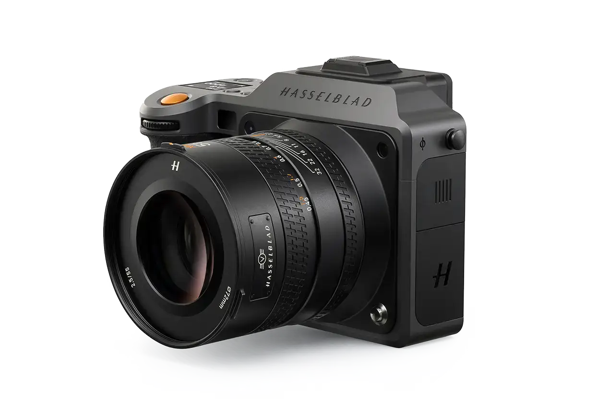

# Hasselblad X2D II

Group: **The Siren family** · Tags: `siren` `hardware` `minimal`
Source: https://www.hasselblad.com/x-system/x2d-ii-100c/ (the maker's official product page; images are the maker's, kept here for study only)

**Why it is here:** The newest Hasselblad camera and its touch UI: the brand's current restraint

- **What makes it work:** Product shots of the camera body: machined grey metal, one orange accent, an X-ray view showing the inside.
- **Controls:** Dials and buttons with a fine knurl.
- **Displays:** Not shown.
- **Colour:** Warm grey metal, black, orange.
- **Lesson for RUIN-1:** Materials do the talking: one finely machined object with a single warm accent.

