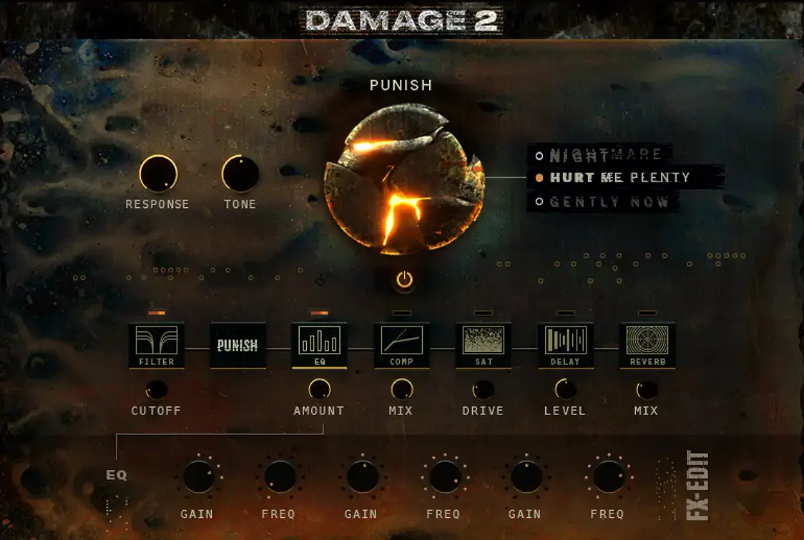
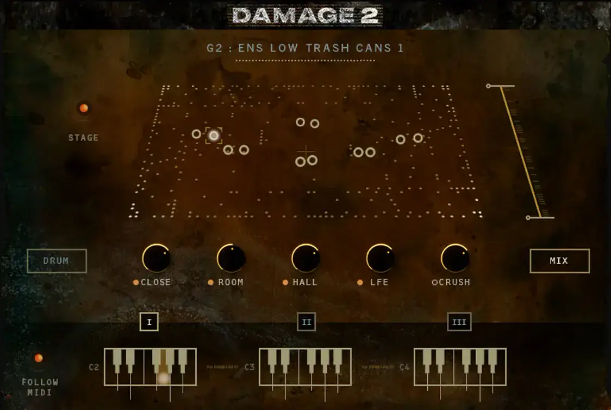
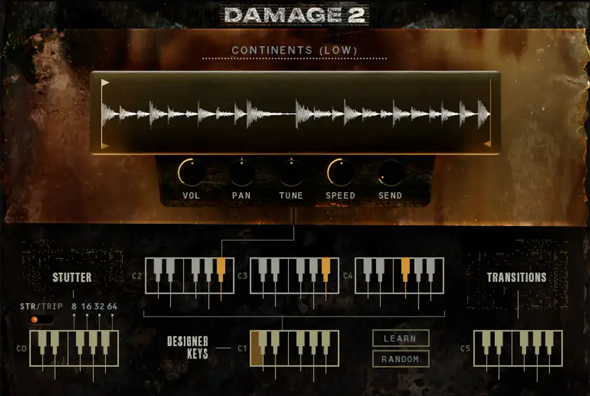
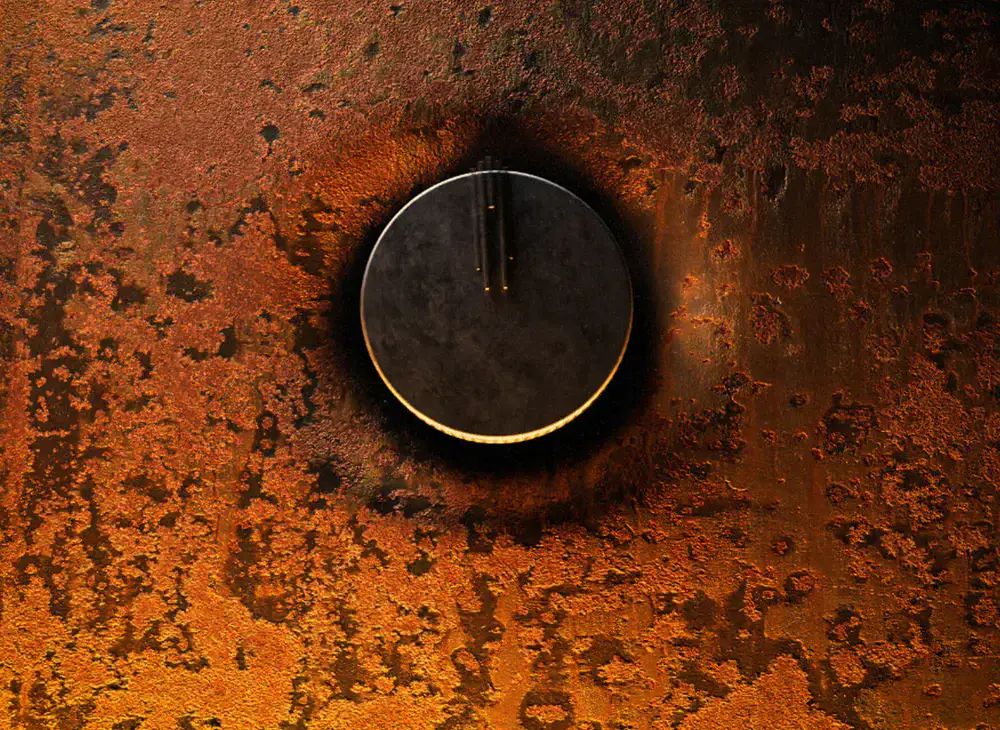

# Heavyocity Damage 2

Group: **Dark, cinematic, LORN-fit** · Tags: `lorn` `dark` `cinematic` `worn`
Source: https://heavyocity.com/product/damage-2/ (the maker's official product page; images are the maker's, kept here for study only)

**Why it is here:** Industrial cinematic percussion: dark, gritty, worn UI

- **What makes it work:** Damage 2: rusted, burnt metal backgrounds, worn type and glowing knobs; the most LORN-like UI in the library.
- **Controls:** Dark knobs with orange glow, a big central 'punish' knob.
- **Displays:** Waveform and stage displays printed on rust.
- **Colour:** Rust, burnt orange, black, warm glow.
- **Lesson for RUIN-1:** Wear and rust as texture under clean controls reads as dangerous and cinematic; keep controls clean on top.

