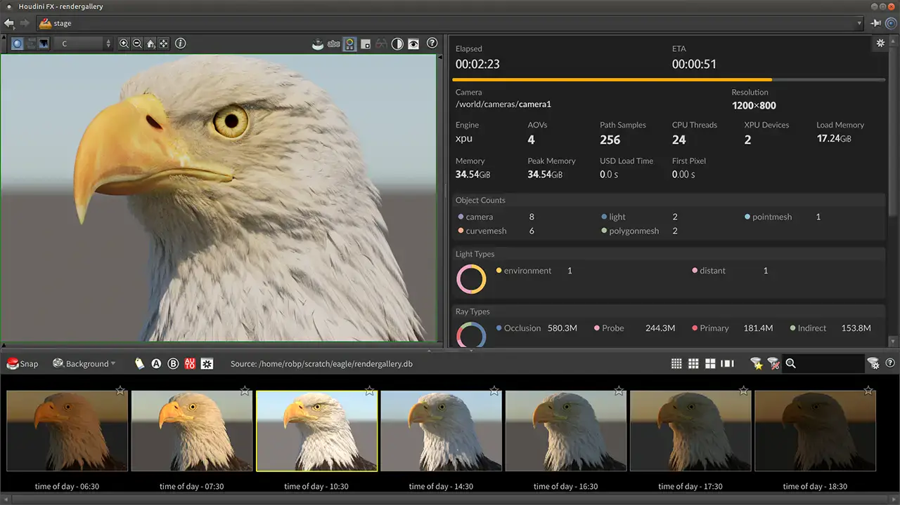
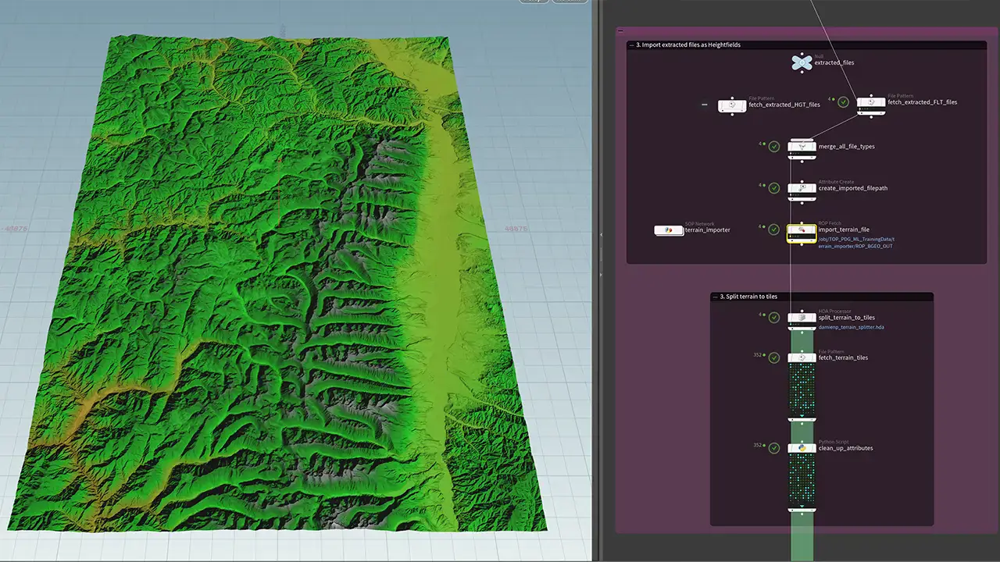

# SideFX Houdini

Group: **Pro software with dense, clear controls** · Tags: `pro` `dark` `dense`
Source: https://www.sidefx.com/products/houdini/ (the maker's official product page; images are the maker's, kept here for study only)

**Why it is here:** Deep technical software with clear parameter panels

- **What makes it work:** Houdini: deep technical software with node networks and long parameter panels.
- **Controls:** Parameter rows with sliders and fields.
- **Displays:** The viewport and node graph.
- **Colour:** Dark grey.
- **Lesson for RUIN-1:** Parameter rows in a strict list are clear for depth, but dull for an instrument.

