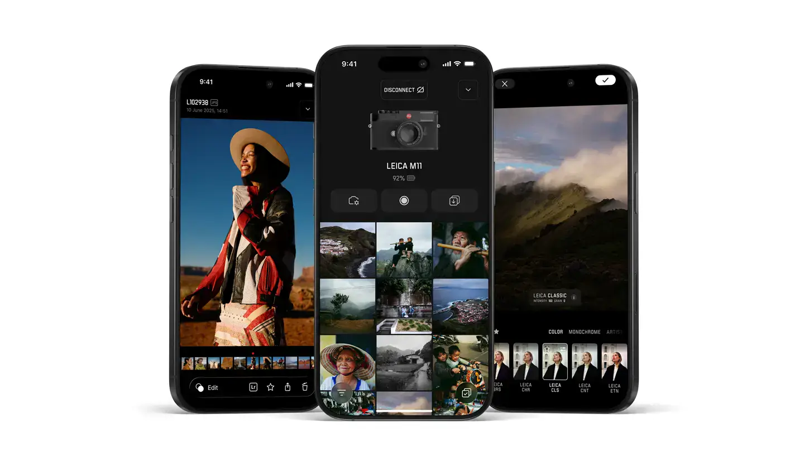

# Leica FOTOS

Group: **The Siren family** · Tags: `siren` `software` `minimal` `red-accent`
Source: https://leica-camera.com/en-int/photography/leica-fotos (the maker's official product page; images are the maker's, kept here for study only)

**Why it is here:** Leica's app: luxury restraint, red as the only accent (like our siren)

- **What makes it work:** Leica FOTOS: black UI, white type, thumbnails, and Leica red only for the brand mark.
- **Controls:** Large tap targets, thin icons.
- **Displays:** Photos are the display.
- **Colour:** Black, white, a single red.
- **Lesson for RUIN-1:** Red used once, for the most important thing, reads as luxury: same as our siren rule.

