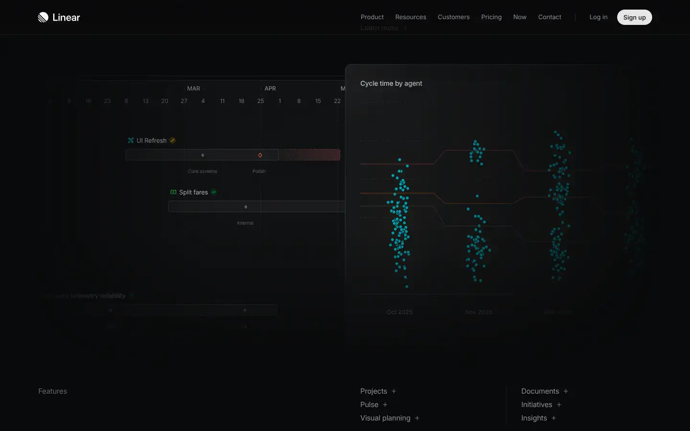

# Linear

Group: **Pro software with dense, clear controls** · Tags: `pro` `dark` `software` `minimal`
Source: https://linear.app (the maker's official product page; images are the maker's, kept here for study only)

**Why it is here:** Premium dark software: tight type, subtle depth, almost no colour

- **What makes it work:** Linear: premium dark software: tiny precise type, almost no colour, depth from subtle surfaces.
- **Controls:** Plain lists and small controls.
- **Displays:** Small charts.
- **Colour:** Near-black, greys, a little violet.
- **Lesson for RUIN-1:** Premium dark comes from precise small type and very subtle surface steps, not decoration.

