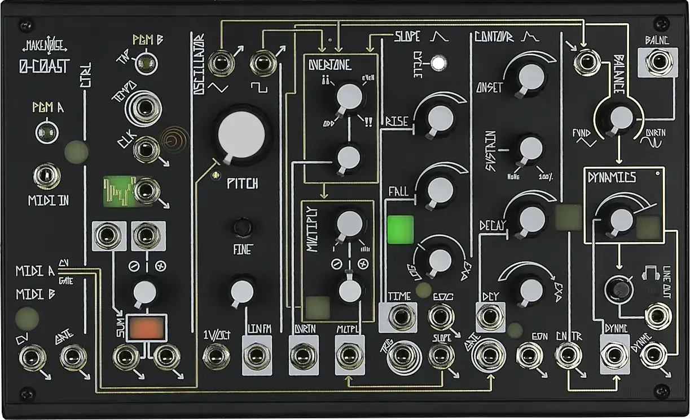
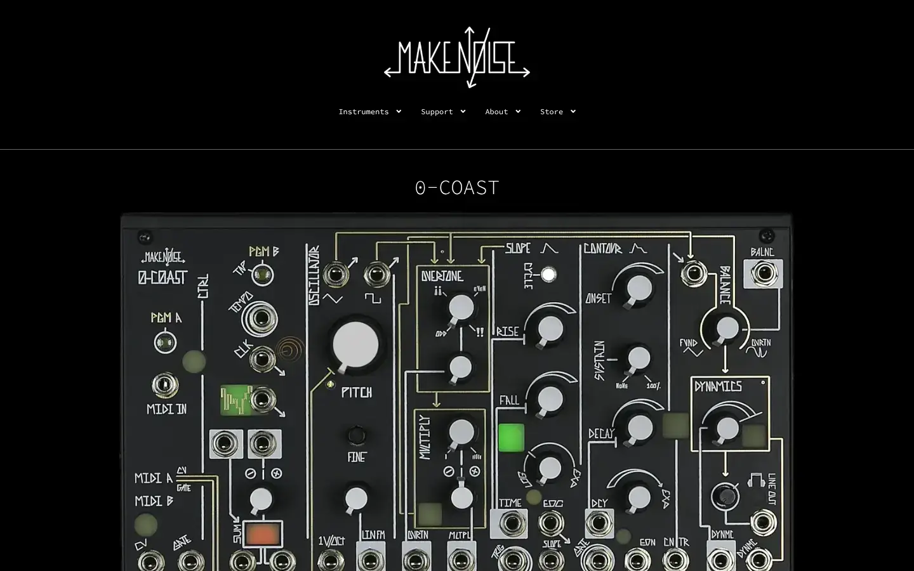

# Make Noise 0-Coast

Group: **Hardware that feels expensive** · Tags: `hardware` `synth` `art-directed`
Source: https://www.makenoisemusic.com/instruments/0-coast/ (the maker's official product page; images are the maker's, kept here for study only)

**Why it is here:** Hand-drawn panel graphics and strong character

- **What makes it work:** 0-Coast: a black panel with hand-drawn white graphics and coloured jacks.
- **Controls:** Knobs of different sizes, coloured jacks.
- **Displays:** None; panel graphics explain flow.
- **Colour:** Black, white line art, a few colours.
- **Lesson for RUIN-1:** Hand-drawn panel graphics give character; flow lines can explain signal path.

