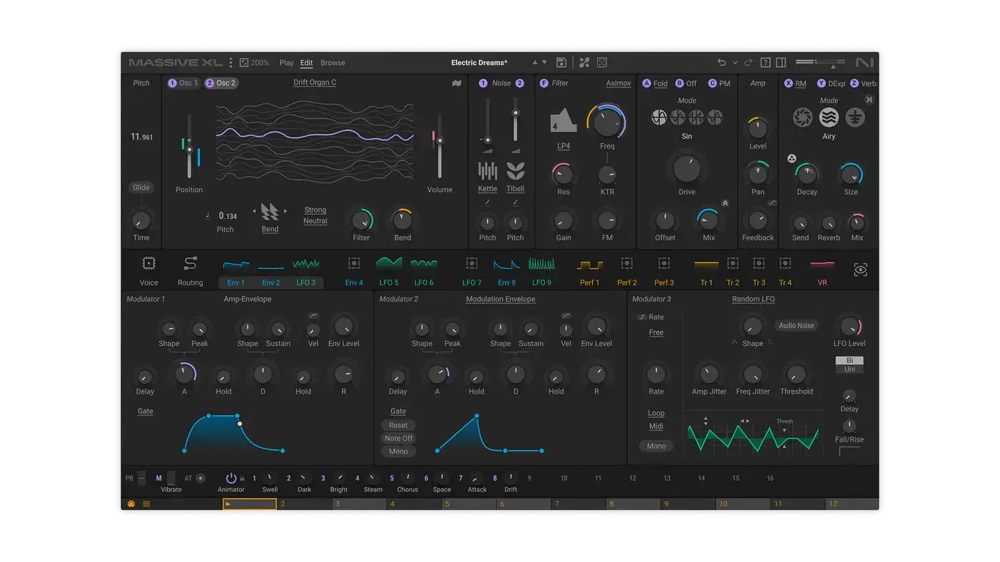
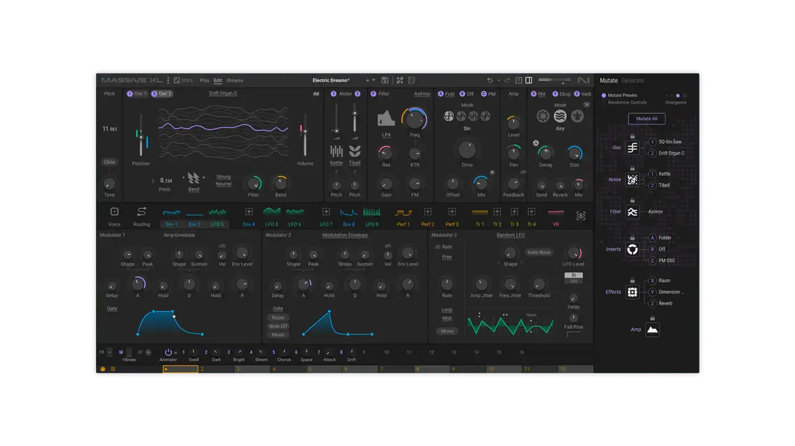
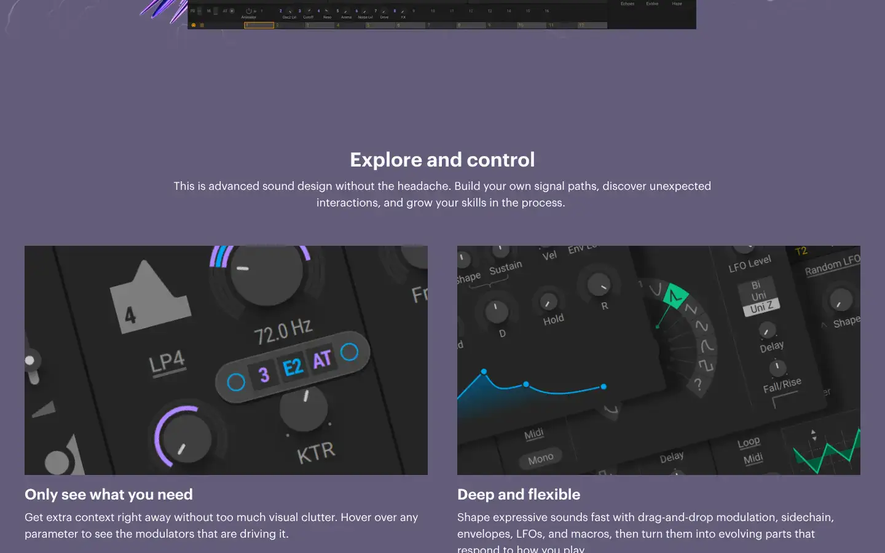
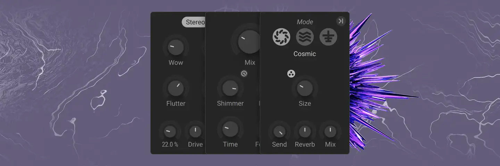

# Native Instruments Massive X

Group: **Synths and plugins** · Tags: `synth` `dark` `dense` `modulation`
Source: https://www.native-instruments.com/en/products/komplete/synths/massive-x/ (the maker's official product page; images are the maker's, kept here for study only)

**Why it is here:** Dense, dark, modular routing with a big tab structure

- **What makes it work:** Massive X: dark, dense, modular panels with small blue displays and a large routing view.
- **Controls:** Many small knobs with blue rings, tab rows.
- **Displays:** Small waveform and envelope displays per module.
- **Colour:** Charcoal with blue and green traces.
- **Lesson for RUIN-1:** Density works when every module has the same grid and the same knob; but too many tabs hide things.

