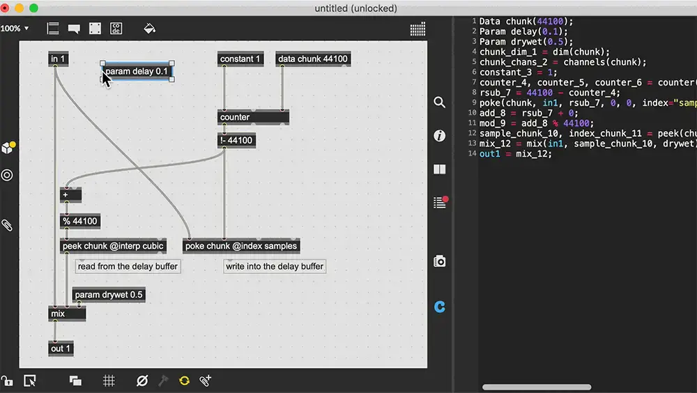
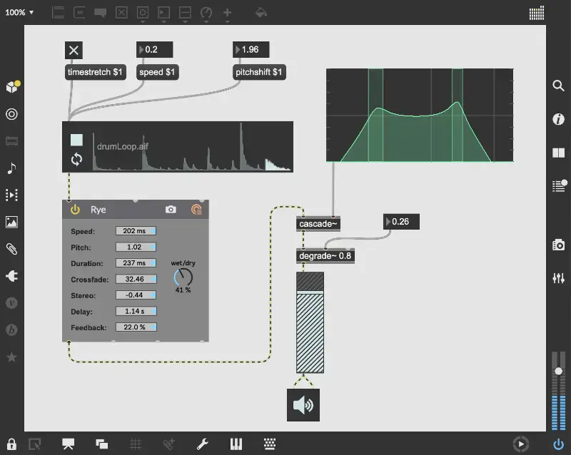
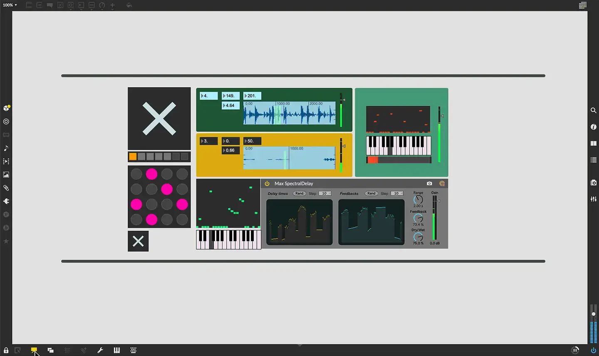

# Cycling '74 Max

Group: **Pro software with dense, clear controls** · Tags: `pro` `music` `modules` `dark`
Source: https://cycling74.com/products/max (the maker's official product page; images are the maker's, kept here for study only)

**Why it is here:** Patchable audio software: dark, modular, technical

- **What makes it work:** Max: patchable audio software: boxes connected by cords, with live UI objects (sliders, scopes, keys).
- **Controls:** Simple sliders, dials and toggles placed freely.
- **Displays:** Scopes and spectrum objects anywhere.
- **Colour:** Grey with coloured objects.
- **Lesson for RUIN-1:** Signal flow drawn as wires makes routing obvious; free placement gets messy fast.

