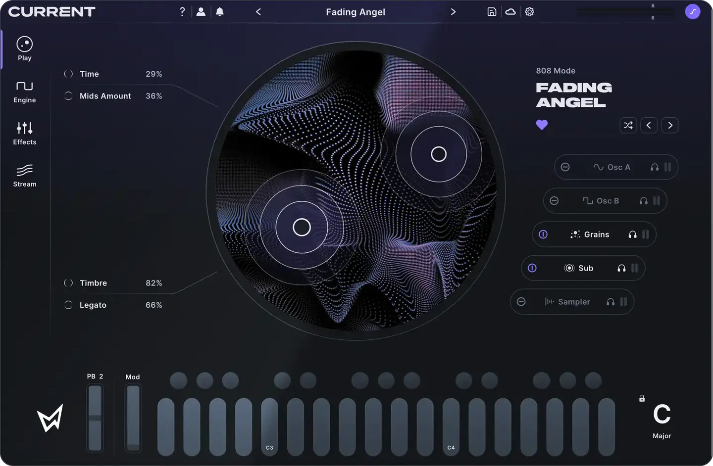
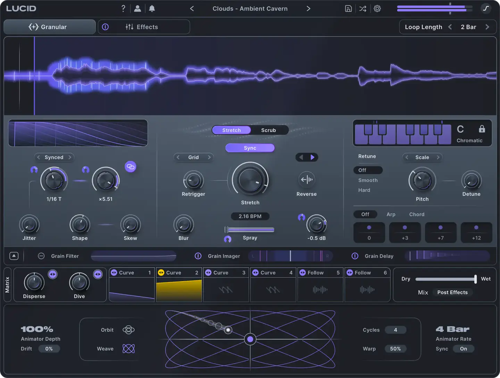
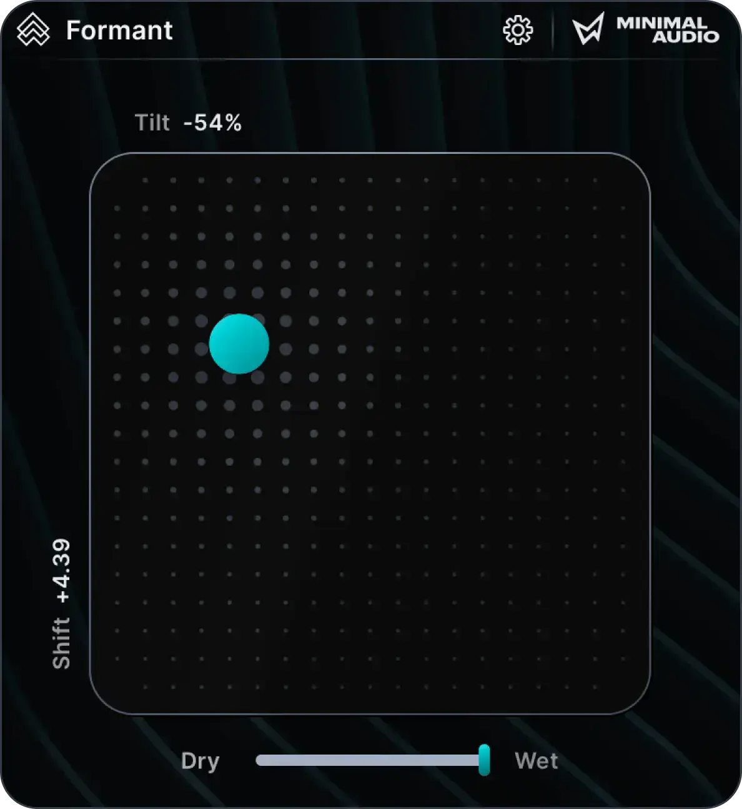

# Minimal Audio Current

Group: **Synths and plugins** · Tags: `synth` `flat` `modulation` `dark`
Source: https://www.minimal.audio/products/current (the maker's official product page; images are the maker's, kept here for study only)

**Why it is here:** A new-generation synth with very clean, premium flat design

- **What makes it work:** Current: a dark navy synth with a large central circular display, keys and macros at the bottom.
- **Controls:** Small knobs, slim sliders, a macro row.
- **Displays:** A big circular, animated sound display at the centre.
- **Colour:** Deep navy, violet accent.
- **Lesson for RUIN-1:** One big, beautiful central display gives a synth a face.

