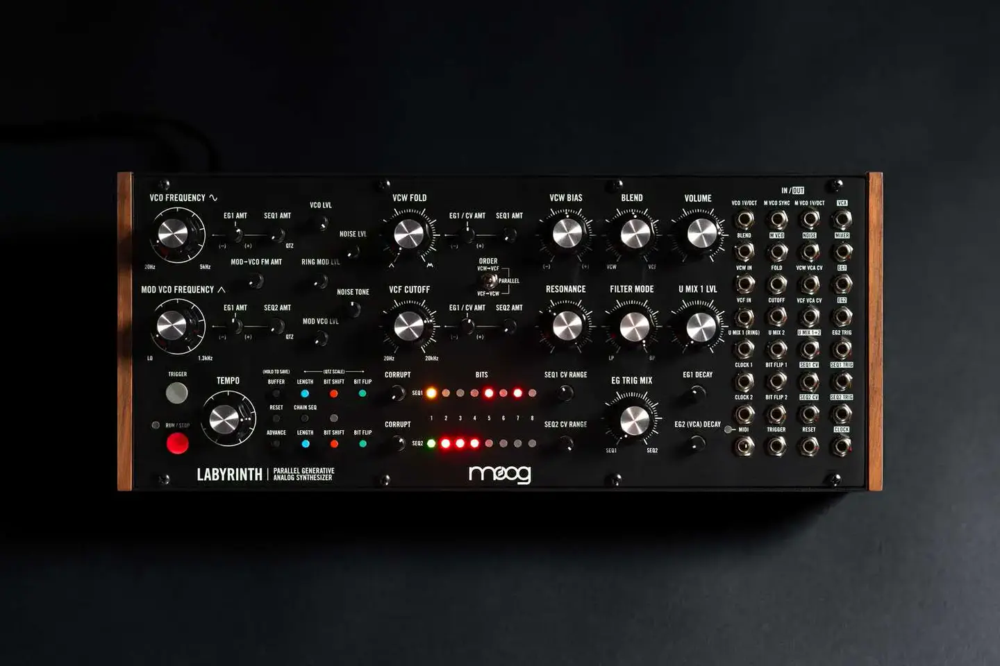
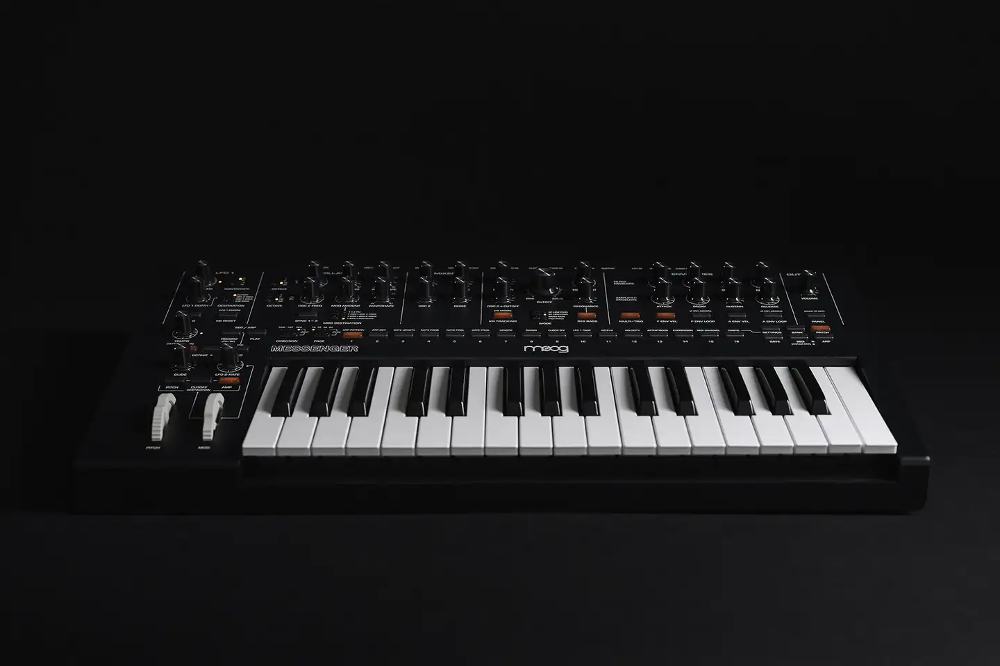

# Moog One

Group: **Hardware that feels expensive** · Tags: `hardware` `synth` `materials` `modules`
Source: https://www.moogmusic.com/products/moog-one (the maker's official product page; images are the maker's, kept here for study only)

**Why it is here:** A flagship synth panel: modules, a central display, premium materials

- **What makes it work:** Moog's own product shots (Labyrinth, Muse): black panels, white legends, rows of black knobs, orange LEDs, wood sides.
- **Controls:** Classic Moog knobs with skirts and white pointers.
- **Displays:** LED rows rather than screens.
- **Colour:** Black, white, wood, a few orange LEDs.
- **Lesson for RUIN-1:** Black panel, white legends, wood and a few orange LEDs is already close to RUIN-1's DNA.

