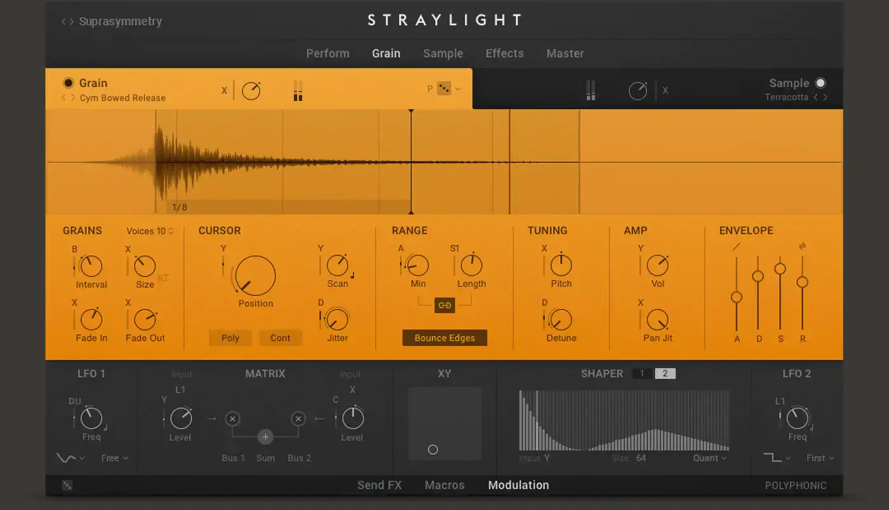
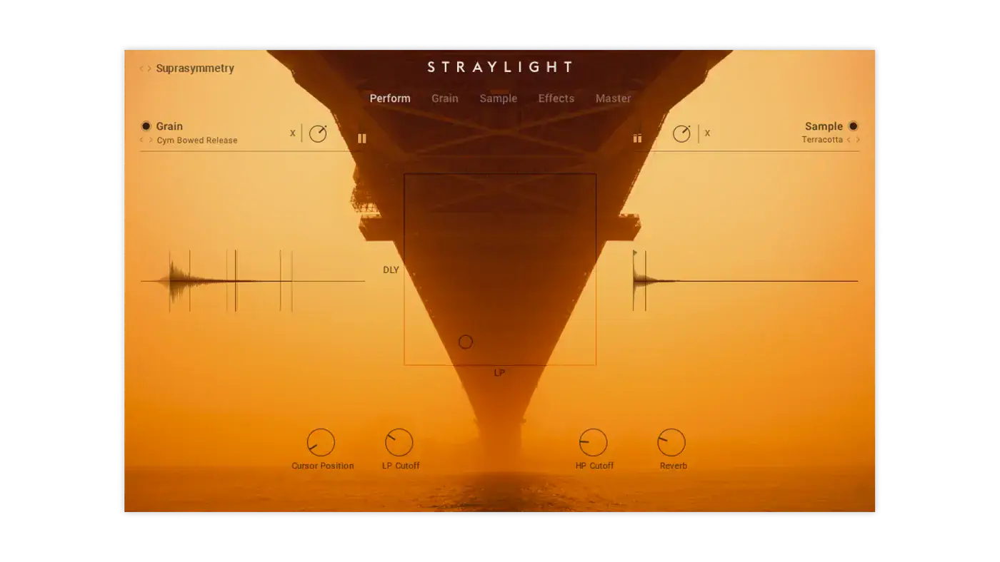
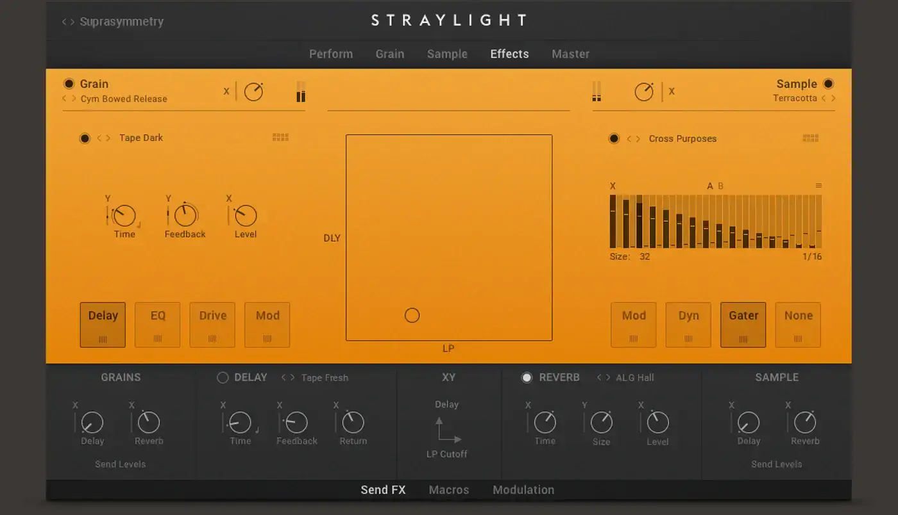
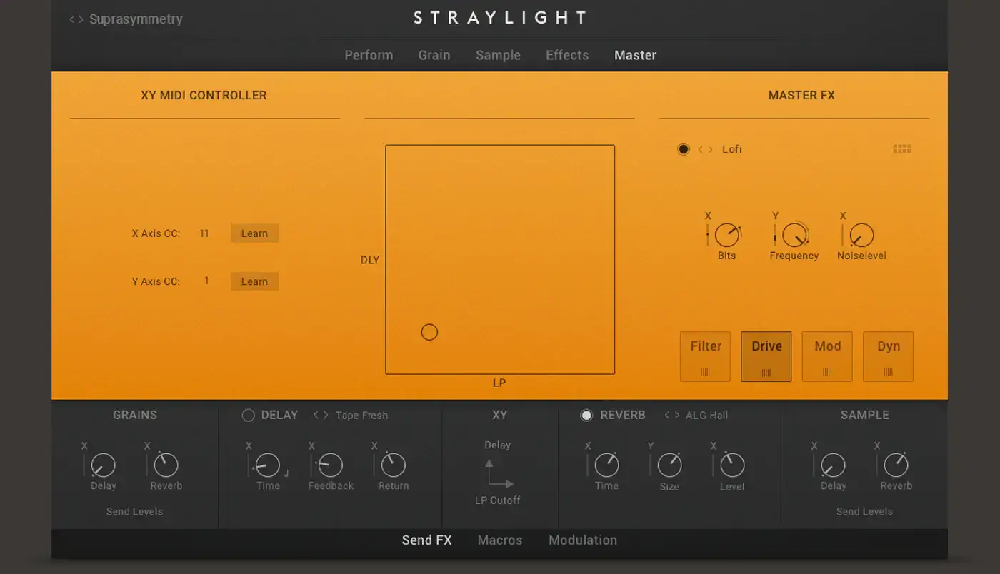

# Native Instruments Straylight

Group: **Dark, cinematic, LORN-fit** · Tags: `lorn` `synth` `dark` `cinematic`
Source: https://www.native-instruments.com/en/products/komplete/synths/straylight/ (the maker's official product page; images are the maker's, kept here for study only)

**Why it is here:** A cinematic pad instrument: dark, atmospheric, a big central display

- **What makes it work:** Straylight: a bold orange sound-design face with a waveform strip on top and modules below.
- **Controls:** Small knobs and sliders under each section header.
- **Displays:** A wide waveform display on top, a cinematic image on the perform page.
- **Colour:** Saturated orange and charcoal.
- **Lesson for RUIN-1:** One bold colour per product can be the brand; a wide display on top anchors the page.

