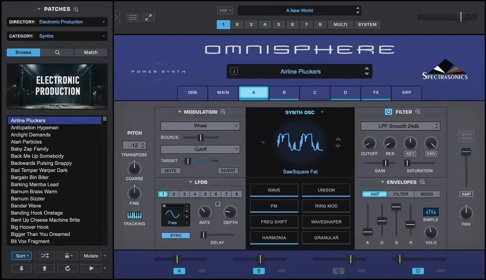
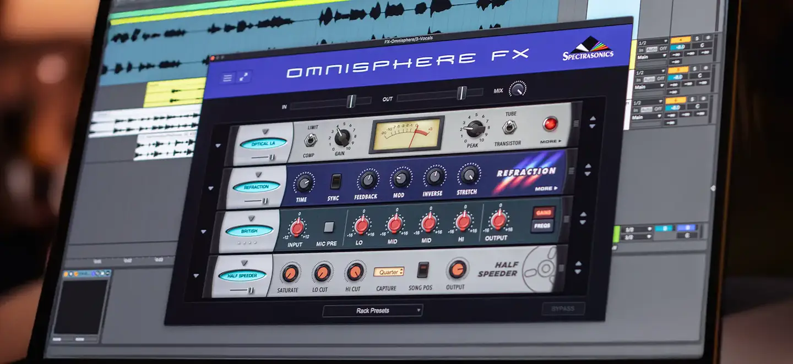
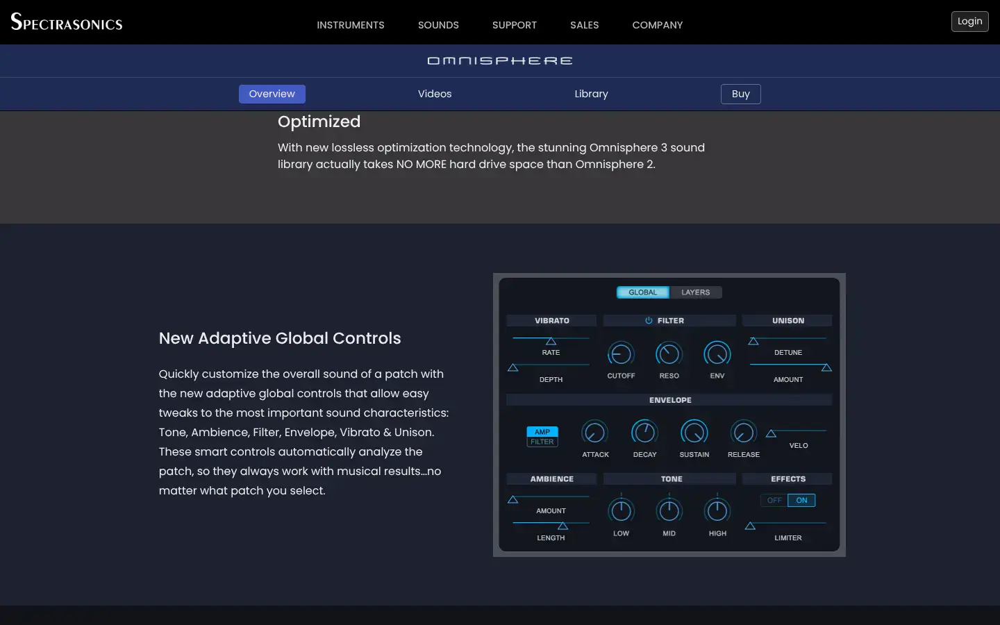
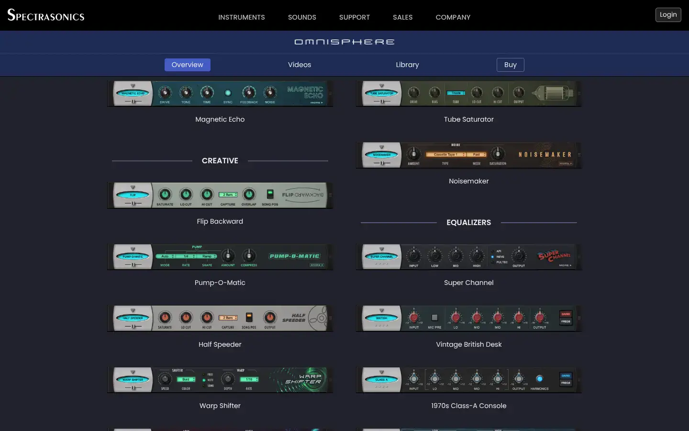

# Spectrasonics Omnisphere

Group: **Synths and plugins** · Tags: `synth` `dark` `cinematic` `dense`
Source: https://www.spectrasonics.net/products/omnisphere/ (the maker's official product page; images are the maker's, kept here for study only)

**Why it is here:** A deep cinematic synth with layered pages and hardware-like panels

- **What makes it work:** Omnisphere: a deep navy synth with a central display, layer tabs, and FX racks drawn as hardware units.
- **Controls:** Flat knobs and sliders; FX units with skeuo faceplates.
- **Displays:** A central waveform display and per-layer views.
- **Colour:** Navy and blue with light grey.
- **Lesson for RUIN-1:** Drawing effects as small hardware units makes a long chain readable.

