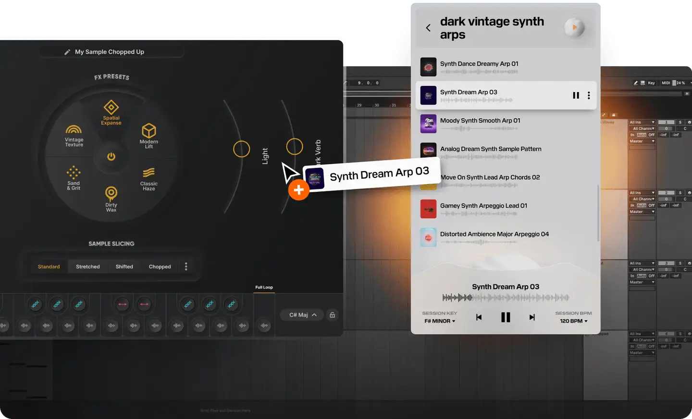
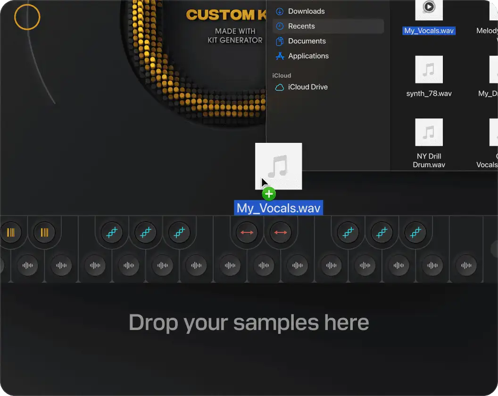

# Output Arcade

Group: **Synths and plugins** · Tags: `synth` `art-directed`
Source: https://output.com/products/arcade (the maker's official product page; images are the maker's, kept here for study only)

**Why it is here:** Consumer-friendly, art-directed instrument; big imagery

- **What makes it work:** Arcade: a dark circular performance view with orange dots and a browser panel beside it.
- **Controls:** Round dial with points; macro knobs.
- **Displays:** Circular visuals around a central dial.
- **Colour:** Dark grey with orange.
- **Lesson for RUIN-1:** A round 'instrument face' feels playable and cinematic.

