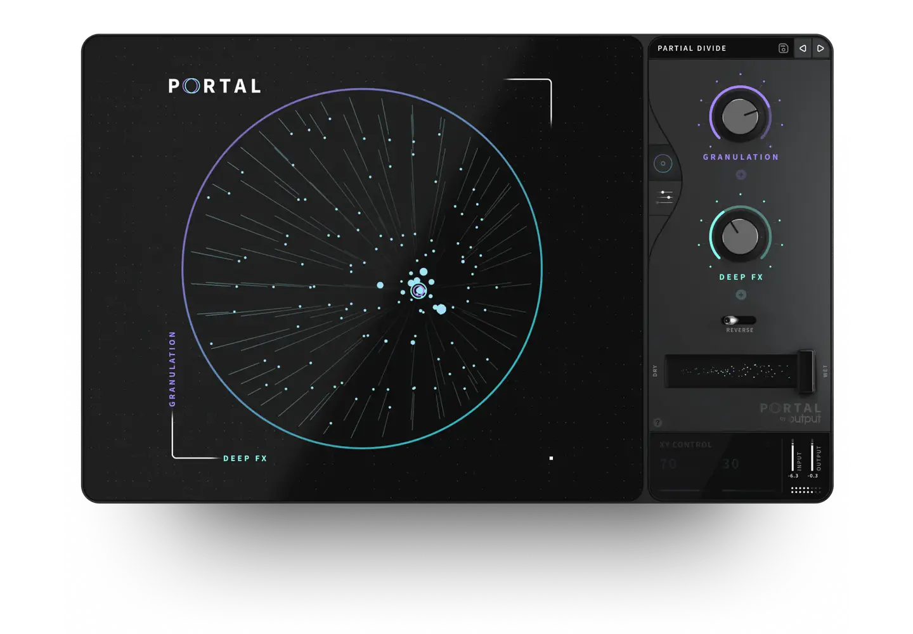
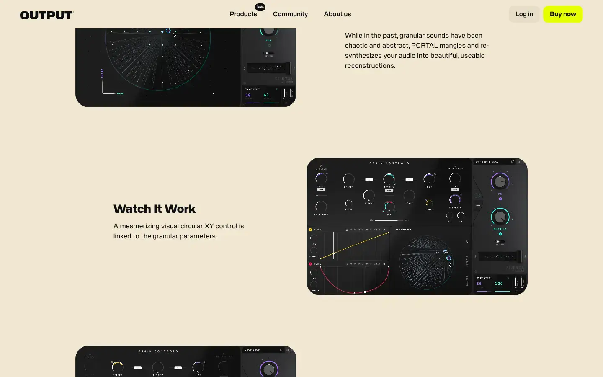

# Output Portal

Group: **Dark, cinematic, LORN-fit** · Tags: `lorn` `plugin` `dark` `cinematic`
Source: https://output.com/products/portal (the maker's official product page; images are the maker's, kept here for study only)

**Why it is here:** A granular effect with a dark, cinematic, animated face

- **What makes it work:** Portal: a dark granular FX with a large circular particle display and a column of knobs at the side.
- **Controls:** A few knobs in a side column.
- **Displays:** A big animated round display.
- **Colour:** Near-black with teal particles.
- **Lesson for RUIN-1:** A big living display plus a narrow control column feels cinematic and calm.

