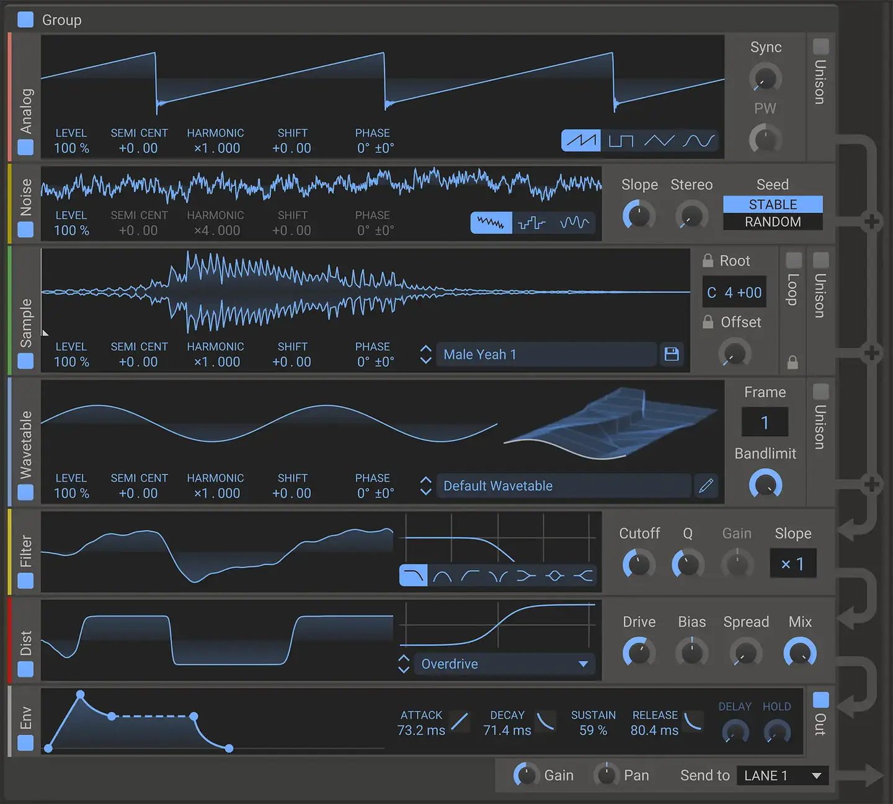
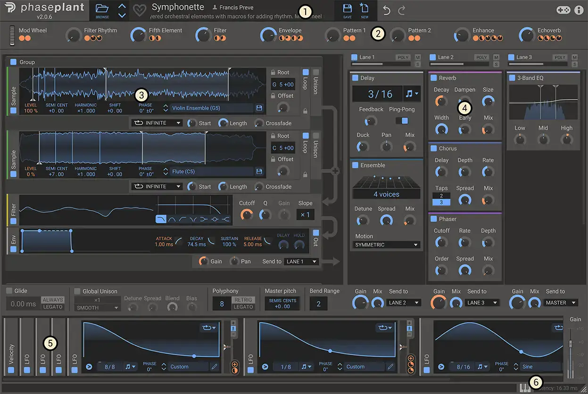
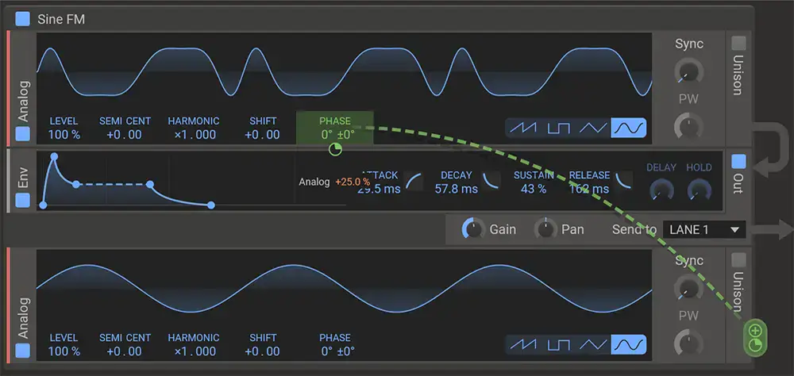

# Kilohearts Phase Plant

Group: **Synths and plugins** · Tags: `synth` `modules` `modulation` `flat`
Source: https://kilohearts.com/docs/phase_plant (the maker's official product page; images are the maker's, kept here for study only)

**Why it is here:** Modular generators in tidy stacked cards; very clear modulation

- **What makes it work:** Phase Plant: modules as stacked cards with a display each; modulation drawn as curved lines between source and target.
- **Controls:** Small knobs, value readouts under each.
- **Displays:** A waveform in every generator card, envelopes drawn as curves.
- **Colour:** Mid grey with blue traces and green modulation lines.
- **Lesson for RUIN-1:** Draw modulation as a visible connection; cards with one display each keep a modular synth readable.

