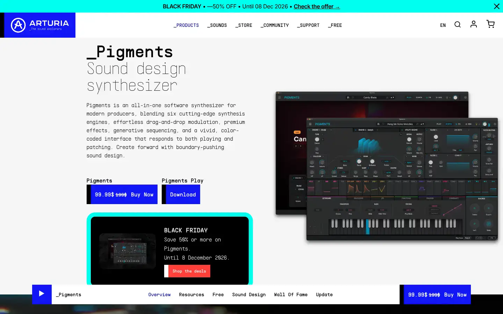
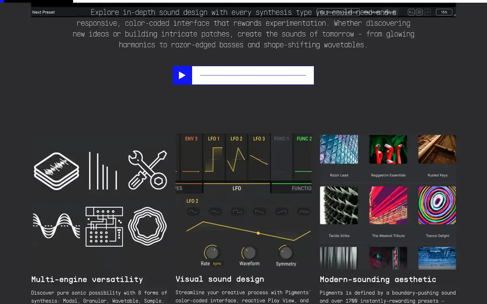

# Arturia Pigments

Group: **Synths and plugins** · Tags: `synth` `displays` `modulation` `colour-coding`
Source: https://www.arturia.com/products/software-instruments/pigments/overview (the maker's official product page; images are the maker's, kept here for study only)

**Why it is here:** Rich colour-coded modulation and animated displays; polished

- **What makes it work:** Pigments: a near-black synth with big animated, colour-coded displays and a coloured modulation system.
- **Controls:** Knobs with colour arcs; modulation sources colour-code their targets.
- **Displays:** Large, vivid, animated displays per engine.
- **Colour:** Black UI, saturated blue/orange/purple per section.
- **Lesson for RUIN-1:** Colour-code by role (source colour on its targets) and animate the displays: alive without extra controls.

