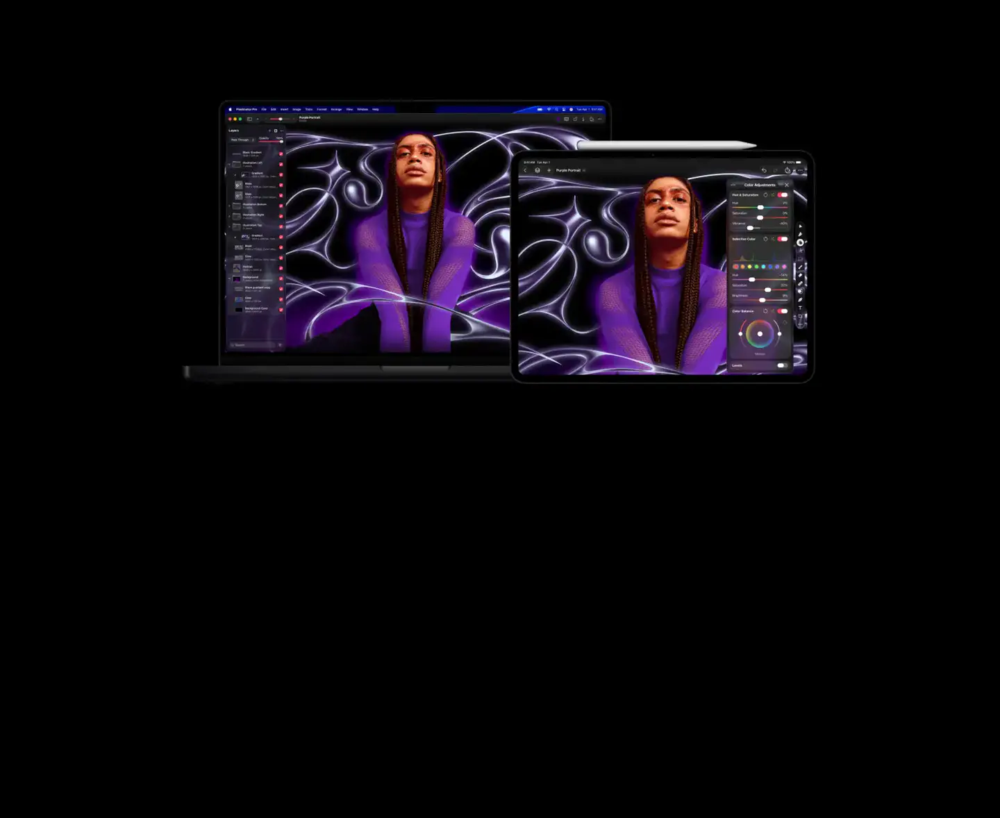
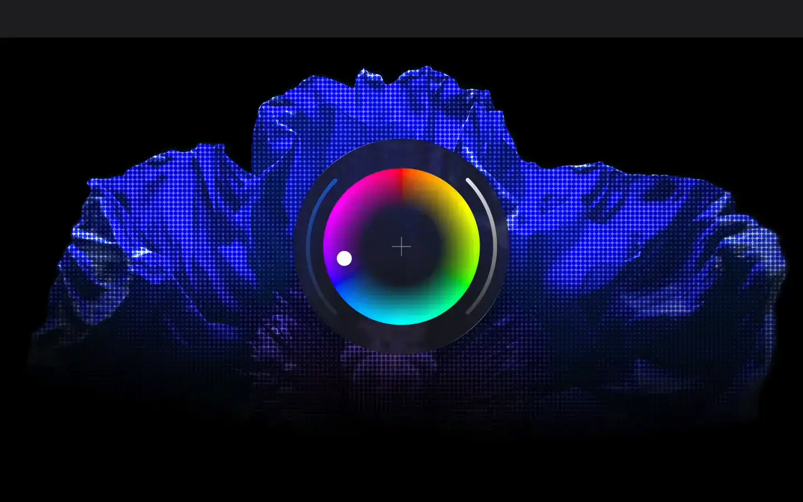

# Pixelmator Pro

Group: **Pro software with dense, clear controls** · Tags: `pro` `dark` `software` `siren`
Source: https://www.pixelmator.com/pro/ (the maker's official product page; images are the maker's, kept here for study only)

**Why it is here:** An Apple-like pro editor: dark, calm, beautiful adjustment panels

- **What makes it work:** Pixelmator Pro: an Apple-like dark editor, calm side panels and a beautiful colour wheel.
- **Controls:** Rounded sliders in grouped panels, a big colour wheel.
- **Displays:** The image is the display.
- **Colour:** Black, white, colour in content only.
- **Lesson for RUIN-1:** Apple restraint: one beautiful custom control (the wheel) among plain ones.

