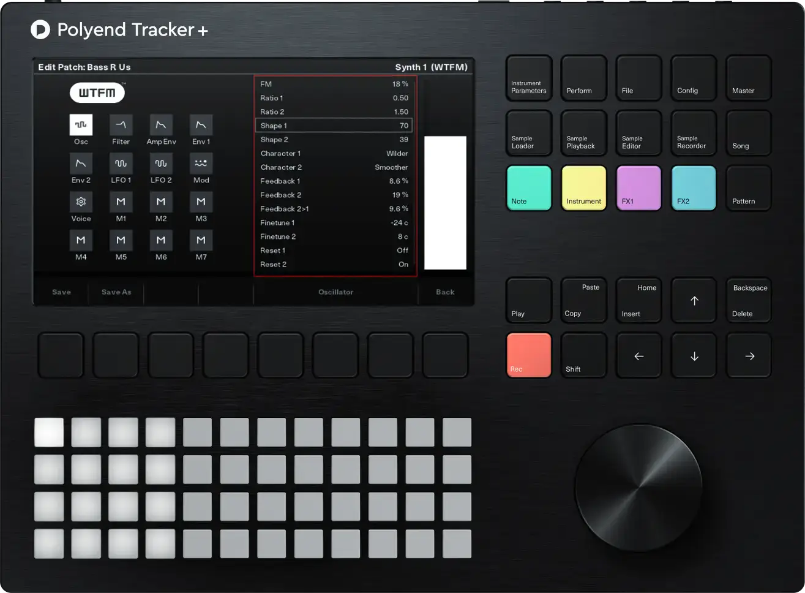
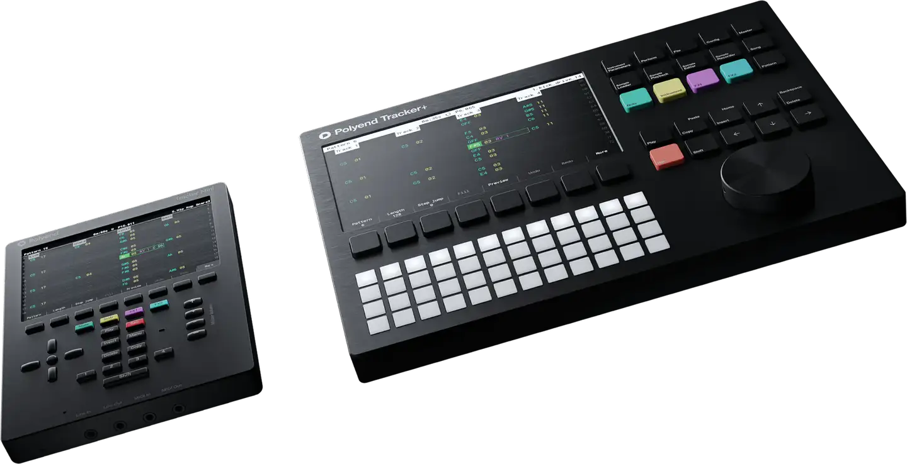
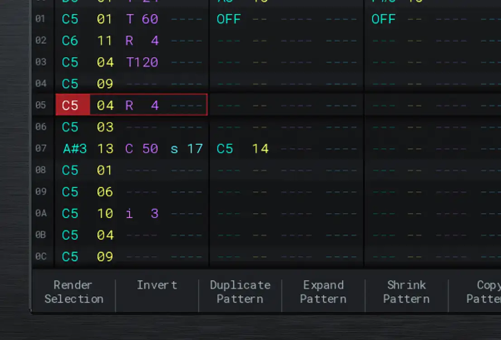
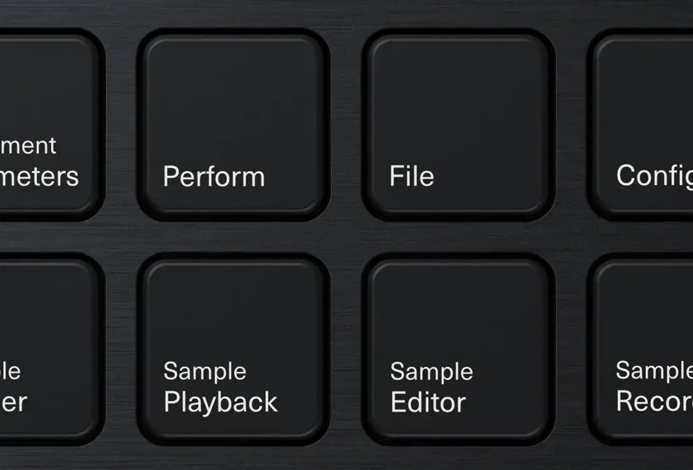

# Polyend Tracker+

Group: **Hardware that feels expensive** · Tags: `hardware` `displays` `minimal`
Source: https://polyend.com/tracker-plus/ (the maker's official product page; images are the maker's, kept here for study only)

**Why it is here:** A screen-first instrument with bold, minimal graphics

- **What makes it work:** Tracker+: a black device with a dense colour screen, white pads, coloured function keys.
- **Controls:** White square pads, a big jog wheel.
- **Displays:** A dense colourful tracker screen; colour-coded patterns.
- **Colour:** Black and white with pastel accents.
- **Lesson for RUIN-1:** A dense screen stays readable with a monospaced grid and colour per track.

