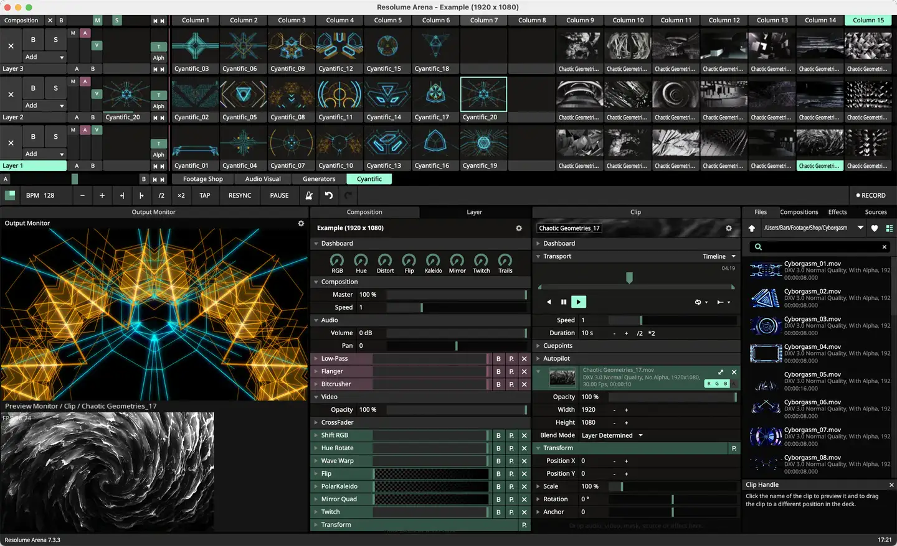
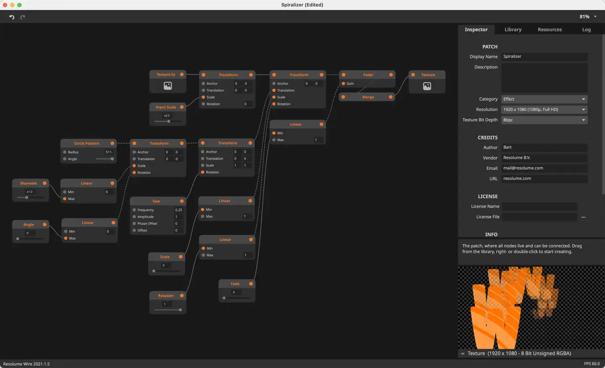

# Resolume

Group: **Pro software with dense, clear controls** · Tags: `pro` `dark` `dense` `performance`
Source: https://resolume.com/software (the maker's official product page; images are the maker's, kept here for study only)

**Why it is here:** Live visuals software: dark, dense, performance-first

- **What makes it work:** Resolume: a dark, dense VJ app: a grid of clips, panels of parameters, node wiring.
- **Controls:** Small sliders and buttons in dense panels.
- **Displays:** Clip thumbnails and a big output view.
- **Colour:** Dark grey with teal accents.
- **Lesson for RUIN-1:** Performance software keeps everything visible at once; density with a clear grid.

