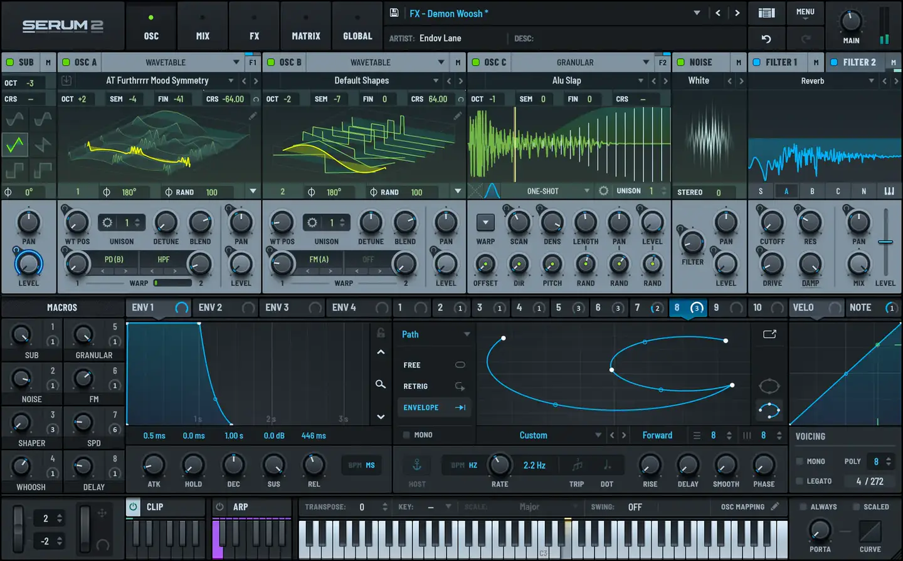
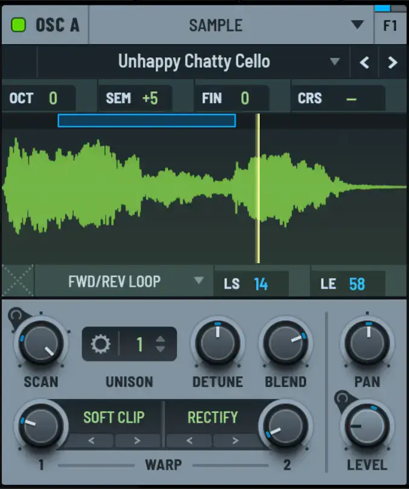
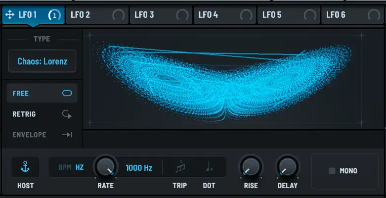
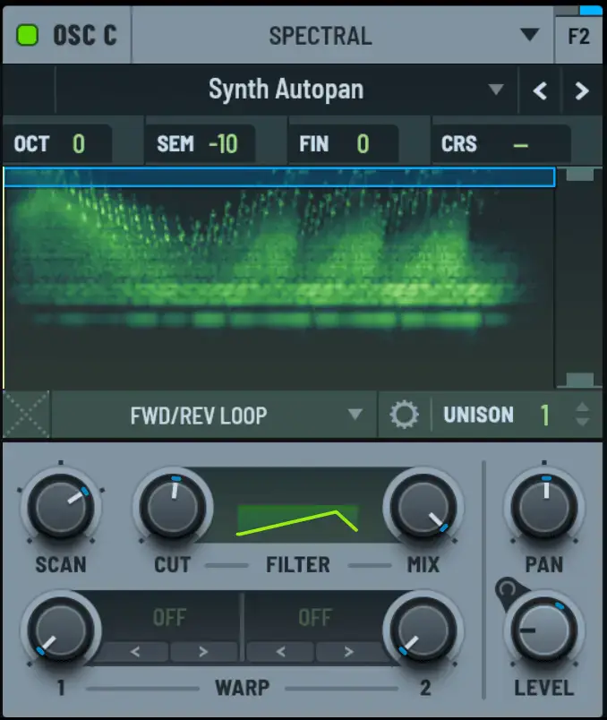

# Xfer Serum 2

Group: **Synths and plugins** · Tags: `synth` `displays` `modulation` `dark`
Source: https://xferrecords.com/products/serum-2 (the maker's official product page; images are the maker's, kept here for study only)

**Why it is here:** The modern synth standard: big animated displays above each module, drag-to-modulate

- **What makes it work:** Serum 2: dark navy panels, a big animated display above each oscillator, a matrix of modulation lanes below.
- **Controls:** Small round knobs with blue value rings; drag-to-modulate.
- **Displays:** Big waveform and wavetable displays above the knobs; LFO shape editors.
- **Colour:** Dark navy, bright blue and green traces.
- **Lesson for RUIN-1:** The display-above-knobs layout is the genre standard; Serum's value rings make every amount readable at a glance.

