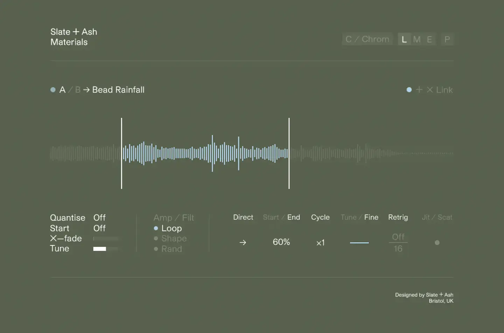
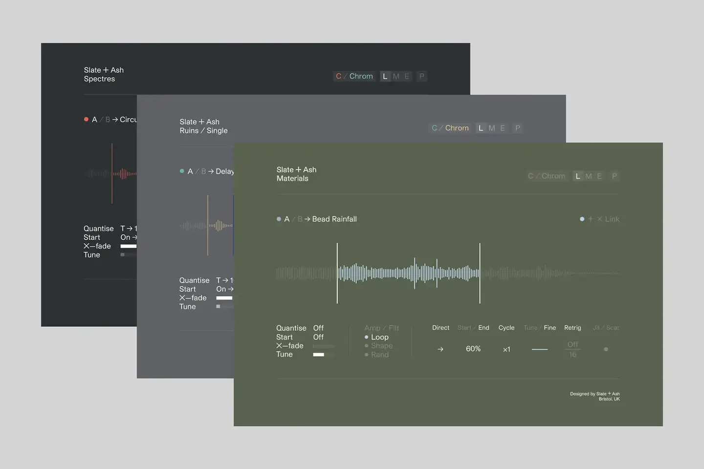

# Slate + Ash

Group: **Dark, cinematic, LORN-fit** · Tags: `lorn` `dark` `cinematic` `art-directed`
Source: https://www.slateandash.com/ (the maker's official product page; images are the maker's, kept here for study only)

**Why it is here:** Dark cinematic instruments with art-directed faces

- **What makes it work:** Slate + Ash: muted olive and grey faces, thin type, a waveform floating in space; restrained and cinematic.
- **Controls:** Few, quiet controls; text values.
- **Displays:** A single waveform as the centrepiece.
- **Colour:** Olive, grey, off-white.
- **Lesson for RUIN-1:** Restraint and thin type feel expensive and cinematic; colour can be muted and still strong.

