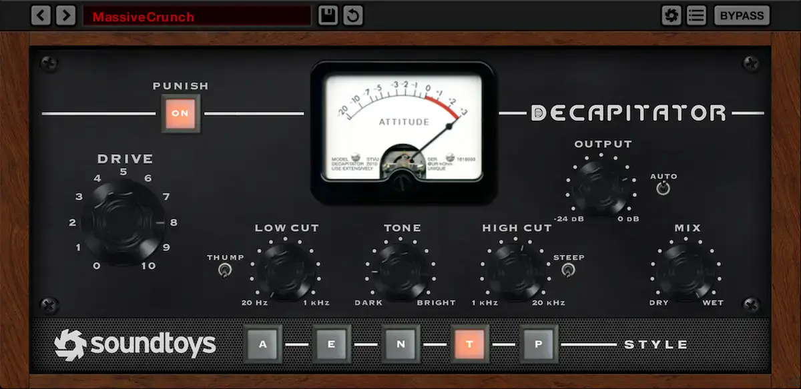
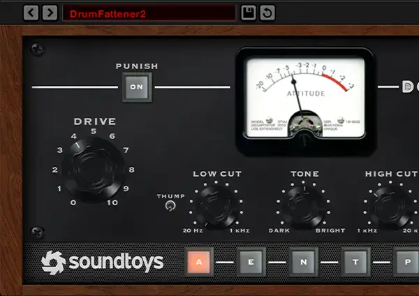

# Soundtoys Decapitator

Group: **Synths and plugins** · Tags: `plugin` `skeuo` `distortion`
Source: https://www.soundtoys.com/product/decapitator/ (the maker's official product page; images are the maker's, kept here for study only)

**Why it is here:** Hardware-style saturation box: few big knobs, strong character

- **What makes it work:** Decapitator: a hardware-style box with a VU meter, chunky knobs and a style switch row.
- **Controls:** Few large knobs with scales printed round them.
- **Displays:** A single VU needle meter.
- **Colour:** Black panel, wood edges, orange highlight.
- **Lesson for RUIN-1:** Few, big, characterful controls with printed scales feel instantly playable.

