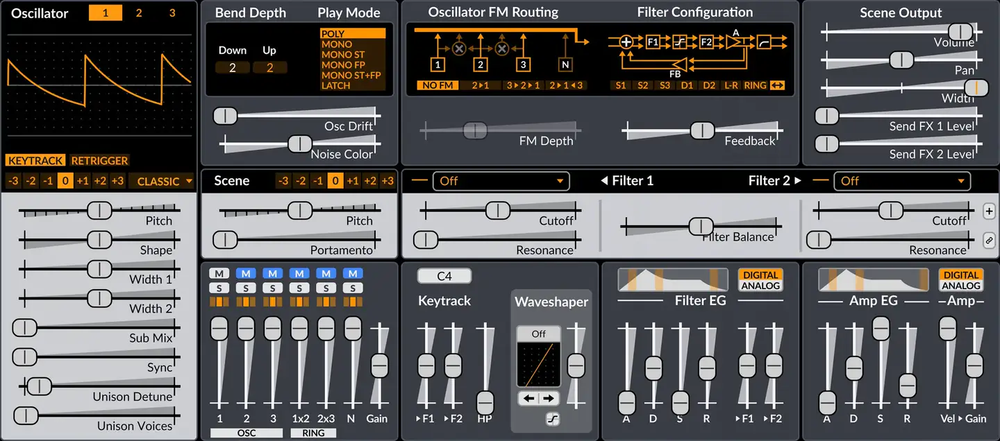
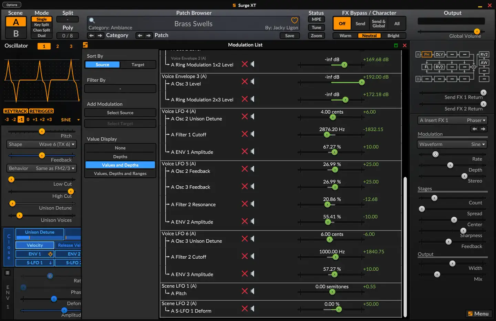
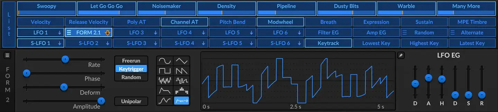

# Surge XT

Group: **Synths and plugins** · Tags: `synth` `flat` `dense` `modulation`
Source: https://surge-synthesizer.github.io/ (the maker's official product page; images are the maker's, kept here for study only)

**Why it is here:** A free, deep synth with skinnable flat panels: one page, many modules

- **What makes it work:** Surge XT: a dense flat panel (grey, orange, blue skins), every module on one page, sliders everywhere.
- **Controls:** Horizontal and vertical sliders more than knobs.
- **Displays:** Small displays for oscillator and filter, a modulation list.
- **Colour:** Skinnable; default grey with orange and blue.
- **Lesson for RUIN-1:** Shows the cost of fitting everything on one flat page: functional but busy. Hierarchy needs size and space, not more boxes.

