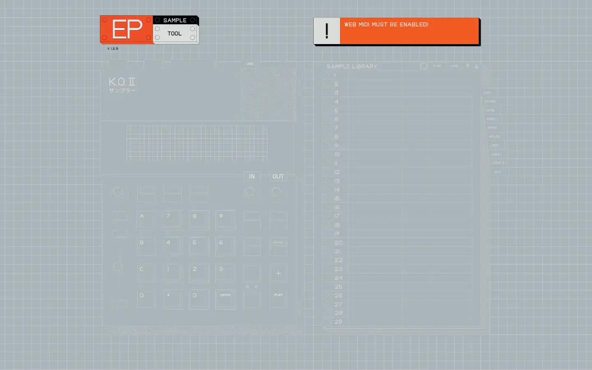

# Teenage Engineering EP sample tool

Group: **The Siren family** · Tags: `siren` `software` `minimal`
Source: https://teenage.engineering/apps/ep-sample-tool (the maker's official product page; images are the maker's, kept here for study only)

**Why it is here:** TE's desktop software: how the brand looks on a computer screen

- **What makes it work:** TE's desktop sample tool: a flat drawing of the device on a pale grid, orange tags as the only accent.
- **Controls:** Software mirrors the hardware layout one to one.
- **Displays:** A flat schematic of the device.
- **Colour:** Pale grey-blue with orange tags.
- **Lesson for RUIN-1:** Software can echo the hardware's layout so the two feel like one instrument.

