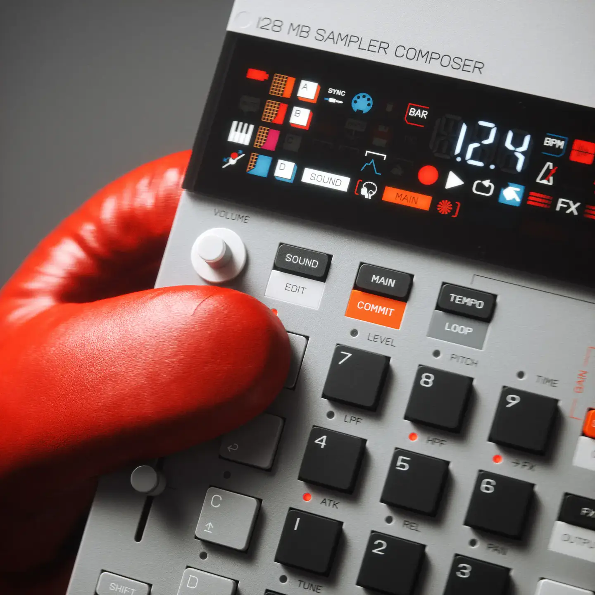
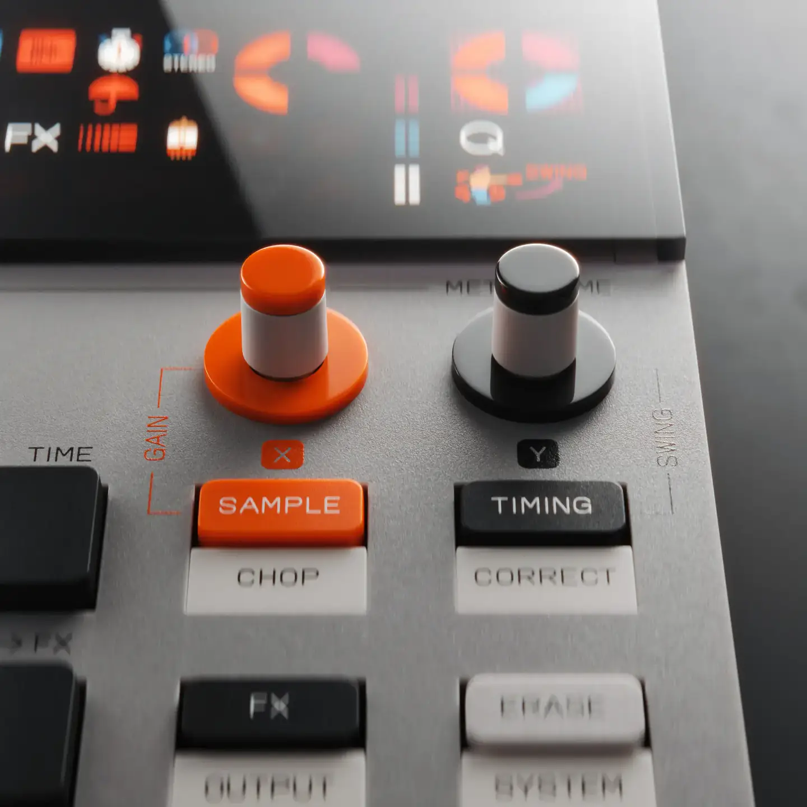
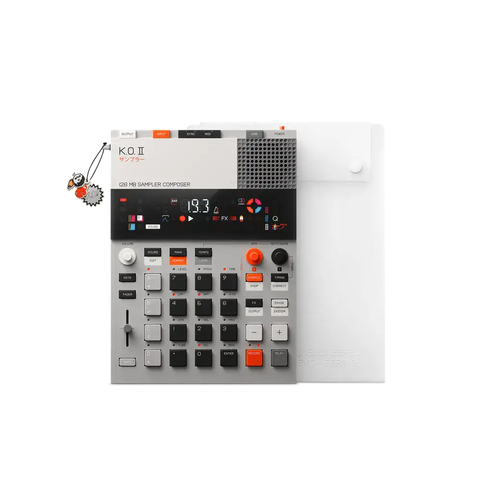
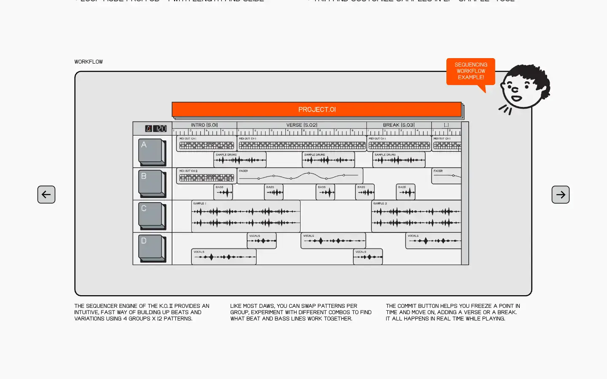
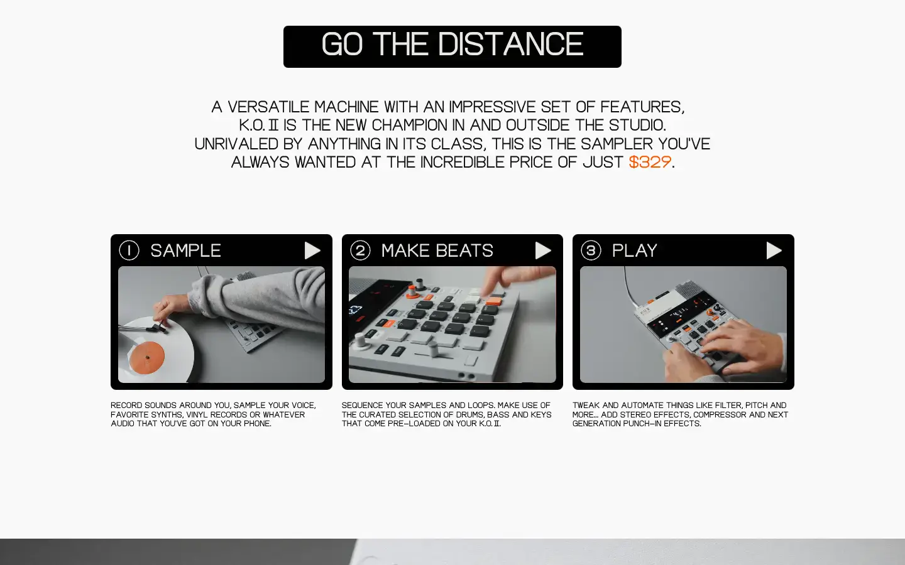

# Teenage Engineering EP-133 K.O. II

Group: **The Siren family** · Tags: `siren` `hardware` `sampler`
Source: https://teenage.engineering/products/ep-133 (the maker's official product page; images are the maker's, kept here for study only)

**Why it is here:** Hardware graphics, segment display and printed labels as the whole UI

- **What makes it work:** EP-133: a grey machined panel, orange and grey keys, a segmented LCD with tiny icons, labels printed on the panel.
- **Controls:** Chunky keys and two big knobs (one orange); labels sit right on the panel.
- **Displays:** A segmented LCD with small pictograms: a few things at once, very legible.
- **Colour:** Light grey, black, orange as the hero colour, small red labels.
- **Lesson for RUIN-1:** Print the labels onto the surface and keep the display to a few big readings; one hero colour.

