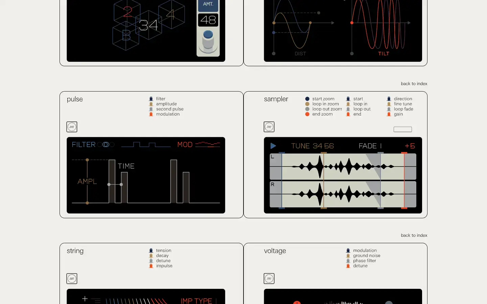
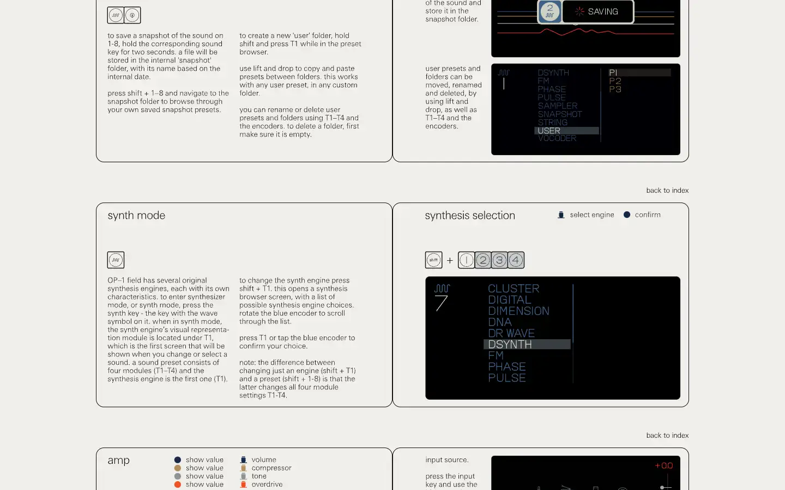
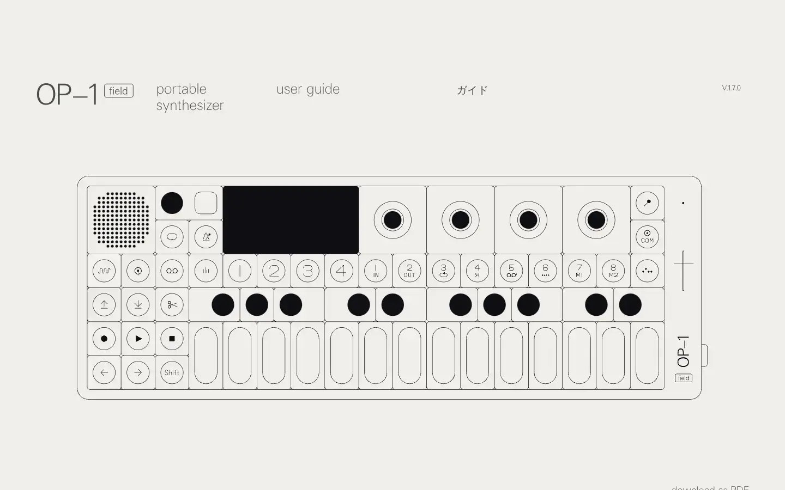

# Teenage Engineering OP-1 field guide

Group: **The Siren family** · Tags: `siren` `synth` `displays` `manual`
Source: https://teenage.engineering/guides/op-1 (the maker's official product page; images are the maker's, kept here for study only)

**Why it is here:** The OP-1 manual: every screen of the device drawn flat, one engine per picture

- **What makes it work:** The manual's flat drawings of every OP-1 screen: synth engines, envelopes and FX each drawn as a simple graphic.
- **Controls:** Not applicable: diagrams.
- **Displays:** Minimal line graphics on black: waveforms, bars and dots, one colour per encoder.
- **Colour:** Off-white pages, black screens, blue/green/white/orange.
- **Lesson for RUIN-1:** A display can explain a module with three or four simple shapes; resist drawing everything.

