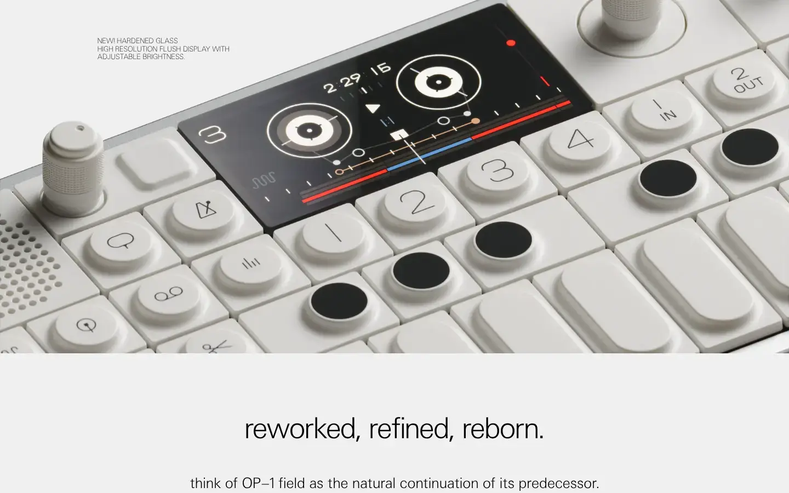
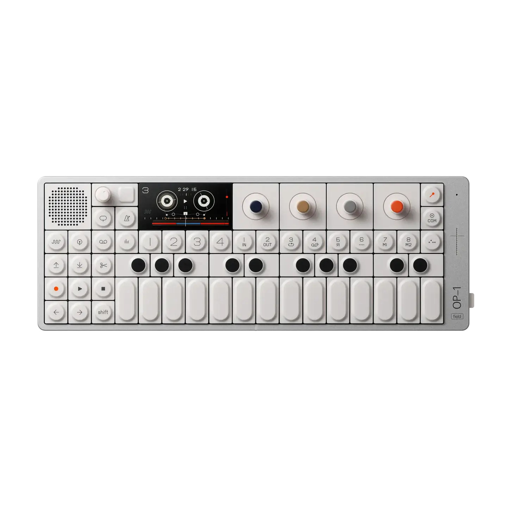
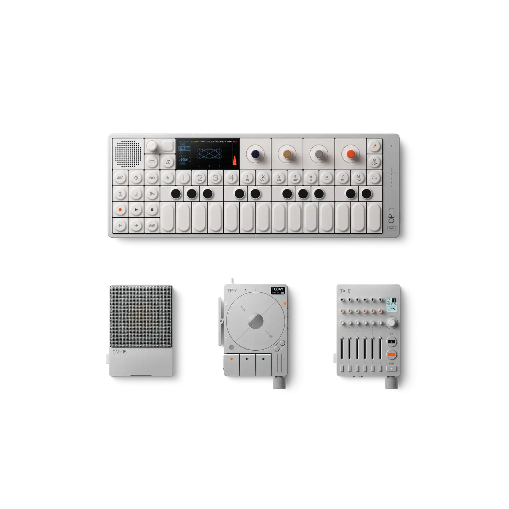
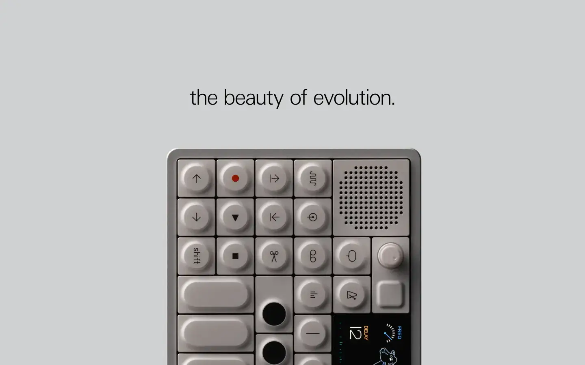

# Teenage Engineering OP-1 field

Group: **The Siren family** · Tags: `siren` `synth` `hardware` `displays`
Source: https://teenage.engineering/products/op-1 (the maker's official product page; images are the maker's, kept here for study only)

**Why it is here:** The OP-1 screen: every synth engine drawn as a playful, readable picture instead of a knob wall

- **What makes it work:** The OP-1 field: a white aluminium body, round coloured encoders, and a small OLED screen that draws each engine as a playful graphic.
- **Controls:** Four colour-coded encoders (blue, green, white, orange), each mapped to the matching colour on screen.
- **Displays:** Tiny OLED graphics: each engine and effect is a picture (tape reels, a cow, circles) instead of a list of numbers.
- **Colour:** Off-white body; screen in white, blue, green, orange on black.
- **Lesson for RUIN-1:** Colour-code controls to their place on the display, and draw each module as a picture of what it does.

